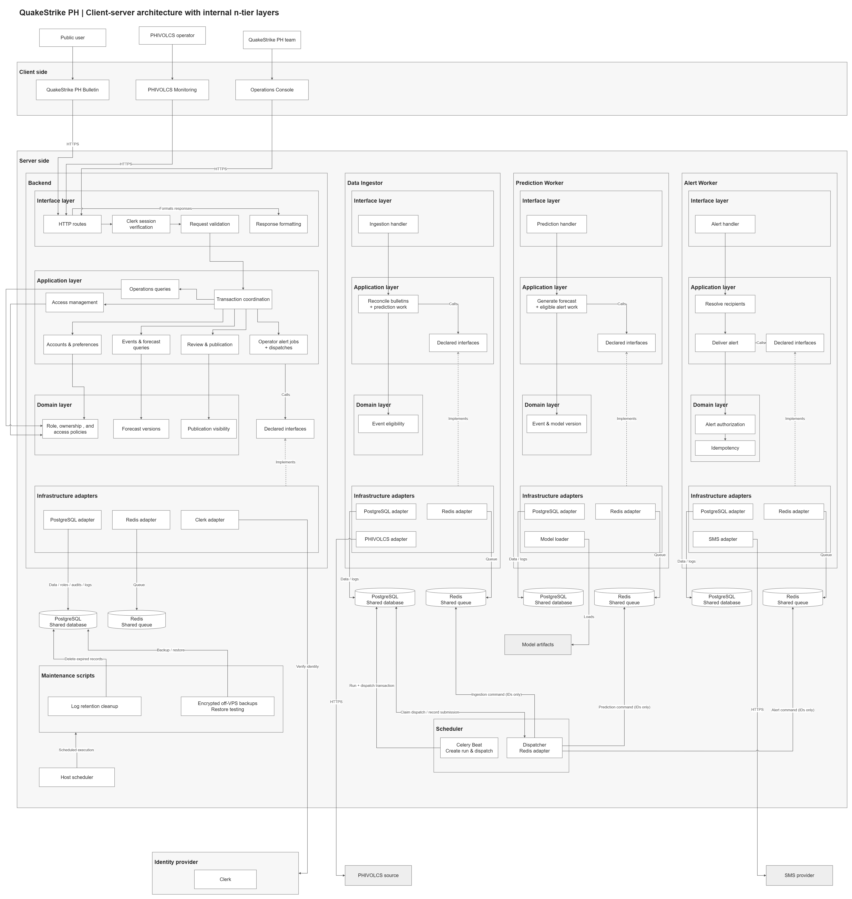

# QuakeStrike PH

QuakeStrike PH is a Philippine earthquake information, forecasting, review,
and alert platform. It ingests PHIVOLCS bulletins, retains corrections as event
revisions, prepares versioned prediction inputs, and supports public
information and protected review and alert workflows.

## How the system fits together

The intended system has three web applications: QuakeStrike PH Bulletin for
the public, PHIVOLCS Monitoring for reviewers, and an Operations Console for
the team. They use a shared Backend API. Python workers ingest bulletins, run
predictions with an approved model release, and deliver approved alerts.
PostgreSQL owns durable records; Redis transports background commands.
Cloudflare Tunnel and Traefik form the public edge.



The main data flow is:

```text
PHIVOLCS bulletins
  -> Beat creates an ingestion run in PostgreSQL
  -> Dispatcher sends the run ID through Redis
  -> Data Ingestor stores events and revisions in PostgreSQL
  -> Dispatcher sends eligible prediction job IDs through Redis
  -> Prediction Worker records forecasts
  -> Backend API serves public and protected applications
```

Alert delivery follows its own approved workflow. Queue commands identify
durable records; PostgreSQL remains the source of truth. The
[architecture specification](docs/system-design/ARCHITECTURE/ARCHITECTURE.md)
describes the full system and its boundaries.

## Repository layout

| Path | Purpose |
| --- | --- |
| `apps/` | Intended homes for Bulletin, PHIVOLCS Monitoring, and Operations Console. |
| `apps/backend-api/` | Intended home for the shared Backend API. |
| `workers/` | Python scheduling, ingestion, prediction, and alert code; migrations and tests. |
| `packages/contracts/queue/` | Versioned schemas for background commands. |
| `infrastructure/` | Local Compose services and deployment configuration. |
| `docs/system-design/` | Architecture, database design, and data-flow diagrams. |
| `docs/adr/` | Accepted architecture decisions. |

This table describes the intended layout; some paths will appear as their
components are built. For branch, commit, test, and pull request instructions,
see [CONTRIBUTING.md](CONTRIBUTING.md).

## Get started locally

These steps use PowerShell from the repository root. They start the local data
services, initialize the database and model release, import preserved history,
and check whether the runtime is ready. Initialization is explicit: starting
containers alone does not migrate or bootstrap an empty database.

### 1. Gather the prerequisites

Install Git, Docker Desktop (or Docker Engine with Compose v2), Python 3.12,
and [`uv`](https://docs.astral.sh/uv/). You also need two inputs kept
outside Git:

1. The approved `SEIS 1.0` model package, including its weight files. Ask the
   project maintainer for the reviewed package.
2. A preserved raw or enriched PHIVOLCS bootstrap snapshot. It must include
   source IDs and URLs, retrieval metadata, counts, and the required August
   25–31, 2026 lookback plus available September records. A cleaned CSV alone
   is not a valid bootstrap input. Ask the maintainer for the preserved
   snapshot or collect a new one from PHIVOLCS with the project scraper.

The snapshot may be copied into the ignored `bootstrap-snapshots/` directory
for the import below.

### 2. Configure the local environment

```powershell
Copy-Item .env.example .env
uv python install 3.12
uv sync --project workers --frozen
```

Edit `.env` before continuing:

- Set `POSTGRES_PASSWORD` and use the same password in `DATABASE_URL`.
- Keep `DATABASE_URL` pointed at `postgres:5432` and `REDIS_URL` at
  `redis:6379`; these are private Compose service names.
- Set `PHIVOLCS_CATALOG_URL` to the official HTTPS catalog URL.
- Set `MODEL_RELEASE_ID` to the ID in the reviewed model manifest.
- Set `MODEL_ARTIFACT_HOST_DIRECTORY` to the host directory where the
  packaged model will live. The default is the ignored `model-artifacts/`
  directory in this repository.
- Set `BOOTSTRAP_REQUIRED_AVAILABLE_THROUGH` to the independently verified
  latest source time that your snapshot must cover.

Do not commit `.env`, model weights, or source data.

### 3. Package the model and prepare the snapshot

Replace the two example paths with the inputs you obtained in step 1:

```powershell
$sourcePackage = 'C:\path\to\reviewed-model-package'
$snapshotPath = 'C:\path\to\preserved-bootstrap-snapshot.json'
New-Item -ItemType Directory -Force bootstrap-snapshots | Out-Null
Copy-Item -LiteralPath $snapshotPath -Destination bootstrap-snapshots/input.json
uv run --project workers quakestrike package-model-release --source-package $sourcePackage
```

The package command verifies the selected release and artifact hashes. Do not
edit the collected snapshot.

### 4. Start PostgreSQL and Redis

```powershell
docker compose --env-file .env -f infrastructure/compose.yml -f infrastructure/compose.release.yml up -d --wait postgres redis
docker compose --env-file .env -f infrastructure/compose.yml -f infrastructure/compose.release.yml build release-init
```

The services stay on a private Docker network. PostgreSQL uses a persistent
Docker volume. The containers do not run migrations or import history for you.

### 5. Initialize the database and model release

```powershell
docker compose --env-file .env -f infrastructure/compose.yml -f infrastructure/compose.release.yml run --rm release-init alembic -c alembic.ini upgrade head
docker compose --env-file .env -f infrastructure/compose.yml -f infrastructure/compose.release.yml run --rm release-init quakestrike register-model-release
```

Registration verifies the packaged model before storing its immutable release
reference. An exact repeat is safe.

### 6. Import history and check readiness

Mount the ignored snapshot directory into the one-off initialization container:

```powershell
$evidencePath = (Resolve-Path bootstrap-snapshots).Path
docker compose --env-file .env -f infrastructure/compose.yml -f infrastructure/compose.release.yml run --rm --volume "${evidencePath}:/app/bootstrap-snapshots" release-init quakestrike bootstrap --snapshot /app/bootstrap-snapshots/input.json --run-manifest /app/bootstrap-snapshots/bootstrap-readiness.json
docker compose --env-file .env -f infrastructure/compose.yml -f infrastructure/compose.release.yml run --rm --volume "${evidencePath}:/app/bootstrap-snapshots" release-init quakestrike startup-check --run-manifest /app/bootstrap-snapshots/bootstrap-readiness.json
```

The last command exits with `0` and prints `"ready": true` when all gates
pass. It checks migrations, PostgreSQL and Redis, the model release and hashes,
the preserved source evidence, the completed backfill, and usable seven-day
history. A failed gate leaves Beat disabled; inspect its diagnostic, correct
the cause, and run the check again. The generated manifest and hash-named
source copy stay in ignored `bootstrap-snapshots/`.

If you later replace the PostgreSQL volume, the imported records disappear.
Starting the containers again will **not** reimport them. Keep the model
package and preserved snapshot. Archive the old
`bootstrap-snapshots/bootstrap-readiness.json` before repeating steps 4–6
against the fresh database: it names a run from the old database. A fresh
manifest gets a new run identity. You do not need to scrape again while the
snapshot remains valid and available.

### 7. Stop local services

```powershell
docker compose --env-file .env -f infrastructure/compose.yml -f infrastructure/compose.release.yml down
```

This stops the containers and retains their volumes. Do not add `-v` unless
you intend to delete the local PostgreSQL and Redis data.

## More documentation

- [Contributing](CONTRIBUTING.md)
- [Architecture specification](docs/system-design/ARCHITECTURE/ARCHITECTURE.md)
- [Database design](docs/system-design/ERD/DATABASE-DESIGN.md)
- [Ingestion vocabulary](CONTEXT.md)
- [Architecture decisions](docs/adr/)
