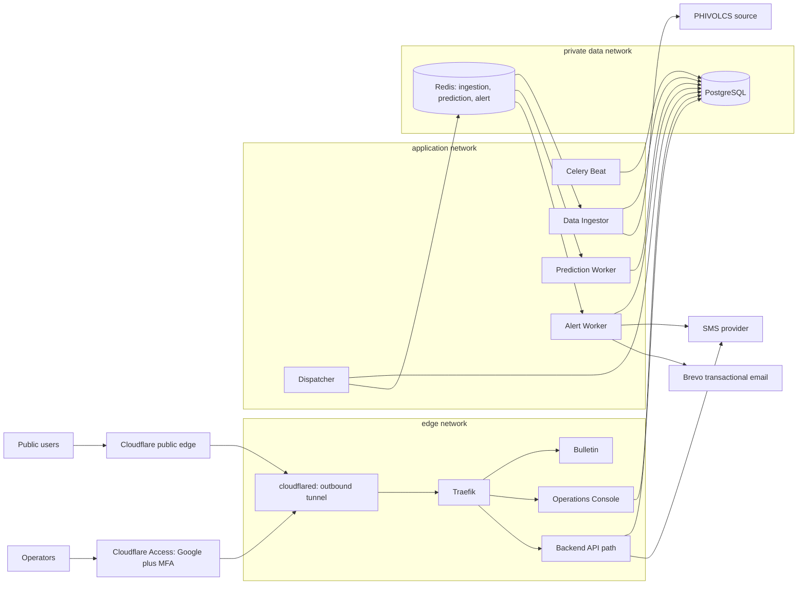

# QuakeStrike PH architecture specification

Status: intended platform design. The trees below specify ownership and dependency direction; they do not claim that the directories already exist or require every private filename to match an example.

QuakeStrike PH is a client-server system on one OVHcloud VPS-2 with 4 vCores, 8 GB RAM, and 75 GB NVMe storage. The public Bulletin uses the shared Backend HTTP interface. The separate Operations Console makes server-side reads of approved PostgreSQL records behind Cloudflare Access. The Backend and workers organize code into Interface, Application, Domain, and Infrastructure layers. Separate Docker containers provide process isolation, not independent data ownership, high availability, or microservices. PostgreSQL is the durable source of truth; Redis is a broker. The system-view, data-flow, and ERD PNGs predate the Console access and email-alert decisions; they are temporarily stale until the separate diagram update. This written specification, the [database contract](../ERD/DATABASE-DESIGN.md), and [ADRs 0035](../../adr/0035-cloudflare-access-operations-console.md), [0036](../../adr/0036-google-accounts-and-independent-phone-verification.md), [0037](../../adr/0037-clerk-free-bulletin-authentication.md), and [0038](../../adr/0038-email-and-sms-alert-preferences.md) control meanwhile, subject to the later ADR amendments.

## Intended monorepo

```text
quakestrikeph/
├── apps/
│   ├── quakestrikeph-bulletin/       # Astro, React, TypeScript
│   ├── operations-console/          # Astro, React, TypeScript
│   └── backend-api/                 # Node.js, Express, TypeScript
├── workers/                         # one Python 3.12 / uv workspace
│   ├── pyproject.toml
│   ├── uv.lock
│   ├── Dockerfile                    # Beat, Dispatcher, Ingestor; distinct commands
│   ├── prediction-worker/Dockerfile # model runtime and its dependencies
│   ├── src/quakestrike/
│   │   ├── domain/
│   │   ├── application/
│   │   ├── infrastructure/
│   │   ├── scheduler/
│   │   ├── data_ingestor/
│   │   ├── prediction_worker/
│   │   ├── alert_worker/
│   │   └── cli.py
│   └── tests/
├── packages/
│   ├── contracts/                   # OpenAPI and versioned queue schemas
│   └── generated-clients/           # generated TypeScript/Python contract code
├── database/
│   ├── migrations/                  # hand-reviewed Alembic revisions
│   ├── initialization/              # release registration and readiness
│   └── maintenance/                 # retention, backup, restore-test commands
├── infrastructure/
│   ├── compose.yml
│   ├── compose.production.yml
│   ├── traefik/
│   ├── cloudflared/
│   ├── backup/
│   └── scripts/
├── model-artifacts/                # local, Git-ignored, build-excluded, read-only mount
├── .env.example
├── CONTEXT.md
└── docs/
```

`packages/contracts` describes HTTP and queue messages, not shared executable business logic. TypeScript and Python implement their own domain code. Do not create a cross-language `shared-backend` bucket that grants arbitrary SQL access. Share a module only when real callers need the same implementation. The [ingestion ADRs](../../adr/0011-python-runtime-and-durable-worker-operations.md) fix the Python runtime and the [queue contract](../../adr/0012-queue-topology-and-operational-safeguards.md) fixes command semantics.

## Technology stack

| Area | Technology | Role |
| --- | --- | --- |
| Web applications | Astro, React, TypeScript | Public Bulletin UI and Access-protected Operations Console server/UI. |
| Backend | Node.js, Express, TypeScript | Bulletin HTTP interface, account rules, and client-facing transactions. |
| Workers | Python 3.12, Celery, Celery Beat, `uv` | Scheduling, durable dispatch, ingestion, prediction, and alert delivery. |
| Persistence | PostgreSQL 16, SQLAlchemy 2, Alembic | Durable application, audit, run, dispatch, delivery, and selected technical records. |
| Queue | Redis 7 | Separate Celery queues and short-lived coordination; never authoritative job state. |
| Public account identity | Clerk free email/password and Google OAuth | Bulletin sign-in, email verification, and sessions; no phone sign-in. |
| Operator access | Cloudflare Access with Google identity and independent MFA | Named-operator admission and signed Console identity. |
| HTTPS edge | Cloudflare Tunnel, `cloudflared`, Traefik | Outbound tunnel and explicit routes; Access protects only the Console hostname. |
| Prediction | Python model runtime and read-only `SEIS 1.0.1` artifacts | Verified training-compatible inference. |
| SMS | IPROG SMS with existing shared sender | Separate phone OTP and automatic SMS alerts; unsupported networks cannot opt in. |
| Alert email | Brevo Transactional Email API | Automatic email alerts, separate from Clerk's authentication emails. |
| Operations | Docker Compose, host scheduler, PostgreSQL records, bounded container logs | Deployment, maintenance, operational history, and local diagnostics. |
| Private database browser | pgAdmin 4, Tailscale Serve | Optional operator access to live PostgreSQL through a read-only role. |

Pin exact tested patch versions in deployment configuration. The major versions above follow the accepted runtime decisions; they are not permission to use floating image tags.

## Container and network layout



Cloudflare sends only the two application hostnames through the tunnel. Cloudflare Access protects the Console hostname with an exact operator allowlist and MFA; the public Bulletin hostname has its explicit `/api` path to the Backend. Console browser requests reach only Console server handlers, which query PostgreSQL directly with approved reads and write their own access events. Only `cloudflared` connects to Cloudflare, and only Traefik accepts tunnel traffic. Traefik has no public dashboard. PostgreSQL, Redis, and worker endpoints have neither tunnel routes nor host port mappings. Containers use Compose service names, not cached IP addresses. Browser code receives no database, Redis, or provider secrets.

The optional pgAdmin container joins the private data network and has a
loopback-only HTTP port on the VPS. Tailscale Serve gives operators a private
HTTPS URL in the tailnet. PgAdmin does not receive a public Cloudflare or
Traefik route. Its PostgreSQL login has read-only grants; see
[ADR 0029](../../adr/0029-private-production-database-browser.md). The
loopback mapping is for the pgAdmin web UI, not PostgreSQL port 5432.

| Network | Members | Permitted traffic |
| --- | --- | --- |
| Edge | `cloudflared`, Traefik, two web apps, Backend HTTP entry | Tunnel to explicit page and Bulletin `/api` routes; Access protects Console traffic. |
| Application | Backend and worker processes | Internal coordination and service health where needed; no public worker route. |
| Private data | Backend, Console server, workers, PostgreSQL, Redis | Restricted database roles and typed queue commands. |
| Private operator access | pgAdmin on the private data network; Tailscale Serve on the VPS host | Tailnet HTTPS to loopback pgAdmin UI; read-only PostgreSQL login. |

External PHIVOLCS, Clerk, and SMS calls use HTTPS. The exact Compose network names are incidental; exposure rules are not. Cloudflare Access authorizes Console entry; Cloudflare Tunnel and Traefik only route traffic. The Console verifies the signed Access application JWT on every page and data request, including signature, issuer, audience, and expiry. TLS termination and forwarding headers must be configured so servers trust only known proxy hops.

## Web applications

Both apps use Astro for pages, React for interactive islands, and TypeScript. Each has its own image and deployment. The Bulletin calls the versioned Backend HTTP interface for public information and account changes. The Console server directly queries approved PostgreSQL tables through purpose-specific, paginated read functions; its browser code never performs SQL. Neither web app publishes queue commands or runs model inference. Clerk signs in Bulletin account holders through Google OAuth. Cloudflare Access admits Console operators through a separate named Google-identity allowlist and independent MFA, without a Clerk operator account or database role assignment.

```text
apps/quakestrikeph-bulletin/
├── Dockerfile
├── package.json
├── astro.config.*
├── src/
│   ├── pages/             # Astro routes and page composition
│   ├── components/        # shared-in-app Astro and React UI
│   ├── features/          # app-owned screens and interaction logic
│   ├── lib/api/           # generated HTTP client wrapper, errors, auth handoff
│   ├── lib/auth/          # Clerk email/password and Google sign-in
│   └── styles/
└── tests/

apps/operations-console/
├── Dockerfile
├── package.json
├── astro.config.*
├── src/
│   ├── pages/             # protected pages and same-origin data handlers
│   ├── features/          # bounded operational views
│   ├── lib/access/        # verified Cloudflare Access JWT and actor context
│   ├── lib/postgres/      # server-only approved read queries and access events
│   └── styles/
└── tests/
```

The Bulletin owns public event, forecast, and playback views, plus authenticated profile and email/SMS alert-setting screens. Public information needs no account; Clerk email/password or Google sign-in is for personal alert settings. Valid persisted forecasts need no review or approval before the public information path can return them. The Operations Console owns read-only ingestion, prediction, alert-delivery, audit, technical-log, maintenance, and user views, plus direct forecast-versus-observation comparisons and linked event context. Its server has a dedicated restricted database connection; its browser does not. It has no Docker socket, host-log reader, user-management authority, export, retry action, or container-control feature. PgAdmin remains the separate all-table browser over Tailscale.

Put app-specific routes under each app's `pages/` and `features/`. Put only genuinely reused browser code in a TypeScript package. The Bulletin's generated Backend client follows `packages/contracts/openapi.yaml`; the Console does not call Backend operations routes. Console queries use selected columns, date bounds, pagination, and parameters, never an arbitrary SQL endpoint. Active run and log views poll about every 30 seconds while open; other views refresh manually and display the last successful refresh time. The Console shows missing or stale records as unavailable or stale, never as a healthy zero. It does not claim live CPU, memory, disk, container restart, Redis depth, or request-rate metrics without an explicit collector. A comparison is per forecast and calls screened observations possibly related earthquakes, not confirmed aftershocks or a model-accuracy study.

## Shared Backend

The Backend uses Node.js, Express, and TypeScript. It serves the Bulletin through versioned HTTP routes and owns public account changes. The Console reads PostgreSQL on its own server and has no operations route dependency on this Backend. The Backend's layers are code responsibilities inside one deployable module, not separate physical tiers.

```text
apps/backend-api/
├── Dockerfile
├── package.json
├── src/
│   ├── interface/http/
│   │   ├── routes/         # public information, account, provider callbacks
│   │   ├── middleware/     # request IDs, Clerk verification, validation
│   │   └── responses/      # contract mapping and error handling
│   ├── application/
│   │   ├── accounts/       # profile and email/SMS settings
│   │   ├── information/    # public events and forecasts
│   │   └── verification/   # alert-phone proof tied to a Clerk user
│   ├── domain/             # account, revision, and alert-setting rules
│   ├── ports/              # interfaces consumed by application/domain
│   ├── infrastructure/
│   │   ├── postgres/       # approved repositories, transactions, queries
│   │   ├── clerk/          # identity verification adapter
│   │   ├── sms/            # phone-verification provider adapter
│   │   ├── logging/        # structured diagnostics and selected SQL logs
│   │   └── queue/          # durable dispatch creation, not direct sends
│   └── config/             # typed environment-backed settings
└── tests/
```

HTTP routes verify identity, validate requests, and format responses. Application use cases coordinate transactions and call declared interfaces. Domain rules decide access, public visibility, alert settings, and idempotency without importing Express, PostgreSQL, Redis, or Clerk. Infrastructure adapters implement the interfaces. Dependencies point inward; routes and adapters do not become the place where business policy is defined. The Backend never calls its own public HTTP routes to do internal work.

Clerk's stable user ID maps uniquely to a Bulletin user. Clerk verifies email/password sign-up before alert setup and handles Google OAuth; Google-first users do not need a password. A phone is optional until SMS is chosen and is never a sign-in identifier. IPROG verification proves an SMS destination but never opts the user in. The Backend owns audited profile changes, verified destination state, and both channel settings. The Console uses its own approved SQL reads and appends `operator_access_events` with the verified Access identity. It cannot use that narrow write grant to alter business records. Access policy, not `users` or Backend code, decides who may operate the Console.

## Background workers and queues

One Python 3.12 workspace uses `uv`, Celery, synchronous SQLAlchemy 2, and hand-reviewed Alembic migrations. Queue handlers are the Interface layer; use cases and pure rules sit inward; PostgreSQL, Redis, PHIVOLCS, model, SMS, and logging code are adapters. The workers do not call Backend HTTP routes for internal data work. Separate Beat, Dispatcher, and Ingestor containers share an application image with distinct commands. Prediction has a separate Python image for model dependencies. The Alert Worker is also Python/Celery and may use the base worker image if its provider dependencies fit.

```text
workers/src/quakestrike/
├── domain/                 # source identity, eligibility, leases, idempotency
├── application/            # reconciliation, feature, prediction, delivery use cases
├── infrastructure/
│   ├── database/           # SQLAlchemy repositories and unit-of-work
│   ├── phivolcs/           # bounded catalog and detail HTTP retrieval
│   ├── queues/             # Celery tasks and versioned commands
│   ├── models/             # manifest and read-only artifact loader
│   ├── sms/                # provider and callback adapters
│   ├── email/              # alert provider and callback adapters
│   └── logging/            # JSON stdout/stderr and selected SQL records
├── scheduler/              # Beat tick; durable Dispatcher loop
├── data_ingestor/          # queue handler, reconcile and feature orchestration
├── prediction_worker/      # queue handler, inference, result commit
├── alert_worker/           # queue handler, recipient/send/reconcile flow
└── cli.py                  # explicit bootstrap, release, recovery commands
```

Beat alone owns the five-minute schedule. It creates one pending `ingestion_runs` record and its `job_dispatches` row in a PostgreSQL transaction, avoiding overlap with an active run. The long-lived Dispatcher claims committed dispatch rows, publishes IDs-only commands to the corresponding Redis/Celery queue, and records submission state. Its claim is not the worker's processing lease. The Ingestor claims the same logical run, fetches the full current PHIVOLCS catalog and detail URLs for new or changed catalog rows or incomplete stored details, validates and reconciles rows, then commits event revisions and any eligible prediction job plus dispatch row atomically. The Ingestor does not publish prediction commands directly; after commit, the shared Dispatcher claims the existing prediction dispatch and routes it to the prediction queue. Missing catalog structure or a conflicting duplicate bulletin ID fails the run; invalid or ambiguous individual rows are counted and do not block valid rows. A detail-page failure preserves a valid catalog row at minute precision with nullable origin and a diagnostic. Absent current-page rows do not delete history. See [identity](../../adr/0013-revision-level-source-identifiers.md), [enrichment](../../adr/0020-detail-page-enrichment.md), [reuse](../../adr/0033-reuse-stored-live-bulletin-details.md), and [atomic processing](../../adr/0016-atomic-event-processing-and-release-registration.md).

A new or changed M1+ revision can create prediction work only with a valid URL, source identity, a configured verified release, seven days of prior history, and a complete versioned feature snapshot. The v1 snapshot contains exactly `anchor_magnitude`, `anchor_depth_km`, `anchor_latitude`, `anchor_longitude`, `anchor_time_is_minute_precision`, `catalog_m1_plus_count_past_1h`, `catalog_m1_plus_count_past_24h`, `catalog_m1_plus_count_past_7d`, `local_m1_plus_count_past_24h_within_50km`, and `local_m1_plus_count_past_24h_within_100km`. It excludes future outcomes and uncertain same-minute ordering. Snapshot JSON and SHA-256 remain immutable. The Prediction Worker loads the referenced job and verified `SEIS 1.0.1` release, runs the selected model routes, and atomically records an attempt, immutable forecast, and one alert job with dispatch and audit for every current, unexpired live M1+ forecast. Historical and backfill work create no alert job. See [feature contract](../../adr/0021-live-feature-contract.md), [automatic-alert scope](../../adr/0027-automatic-alerts-without-forecast-review.md), and [database transaction rules](../ERD/DATABASE-DESIGN.md#transactions-and-cross-table-rules).

The Alert Worker accepts only durable automatic alert work. It resolves at most one recipient per enabled channel for each active account whose observed-magnitude and optional nearby-only rule qualifies. Email needs the current verified Clerk email and email opt-in. SMS needs the current verified phone, SMS opt-in, and ordinary shared-sender network support. It snapshots eligibility, rechecks current settings and expiry before each provider call, and persists a channel-specific attempt before calling the provider. Provider submission is outside the SQL transaction. Brevo's transactional API handles alert email and its message ID identifies an accepted provider request, not inbox delivery. Authenticated, idempotent transactional webhooks reconcile email outcomes. Unknown outcomes require reconciliation, not blind resend; callbacks cannot regress a delivered result. A job stops new sends at its forecast window end, while late outcomes may still update evidence. See the [alert tables](../ERD/DATABASE-DESIGN.md#alerts) and [two-channel decision](../../adr/0038-email-and-sms-alert-preferences.md).

Redis has separate ingestion, prediction, and alert queues. Commands carry a version and stable database identifiers, never scraped HTML, full events, or CSV paths. PostgreSQL owns status, retries, leases, dispatch, and idempotency. Celery uses late acknowledgement and worker-loss rejection; duplicate delivery is expected. The [queue ADR](../../adr/0012-queue-topology-and-operational-safeguards.md) sets the initial dispatcher batch, lease, concurrency, and retry safeguards. Manual recovery requeues existing run/dispatch identities. A failed backfill recovered after its 30-day checkpoint window starts a new run from the preserved snapshot, as defined by [ADR 0034](../../adr/0034-bound-successful-ingestion-checkpoints.md).

## Contracts, data, and model assets

`packages/contracts` holds the versioned Bulletin OpenAPI definition, queue-message schemas, and their compatibility rules. Generated clients and models are derived outputs, not a second source of truth. A contract change must remain compatible with still-running containers during deployment or require a coordinated release. The Backend, Console server, and Python workers can read shared PostgreSQL data only through purpose-specific adapters and restricted roles. The [database specification](../ERD/DATABASE-DESIGN.md) controls tables, ownership, constraints, and transactions.

| Records | Writer | Other consumers |
| --- | --- | --- |
| Events and revisions | Data Ingestor | Backend, Prediction Worker, Console context reads |
| Ingestion run | Beat creates; Ingestor processes | Console reads |
| Dispatch submission | Dispatcher, after a creator inserts the row | Workers, Console reads |
| Prediction jobs and snapshots | Data Ingestor | Prediction Worker, Console reads |
| Prediction attempts and forecasts | Prediction Worker | Backend, Alert Worker, Console reads |
| Profiles, verified email/phone, and alert settings | Backend, with Clerk email evidence and IPROG phone proof | Alert Worker and Console reads with sensitive-field reveal |
| Automatic alert jobs | Prediction Worker | Alert Worker, Console reads |
| Recipients and delivery attempts | Alert Worker | Backend and Console reads |
| Business audits and selected technical logs | Acting/emitting server module | Console reads |
| Console access events | Console server | Console reads and bounded host cleanup |
| Maintenance results | Restricted host maintenance scripts | Console reads |

PostgreSQL runs in its own container on `postgres_data`; Redis uses a named volume when queue persistence is enabled. Neither volume is an off-VPS backup. Use separate migration, Backend, worker, Console, maintenance, and backup database roles with grants limited to their work. The Console role has `SELECT` only on named operational and linked-context tables, plus `SELECT, INSERT` on its access-event table; no business writes. PostgreSQL has a `pg_isready` health check and no public port 5432 mapping. Redis is not the system of record. The model release row is immutable; the normalized manifest records exact routes, target mappings, features, runtime provenance, and SHA-256 hashes. `MODEL_RELEASE_ID` selects a release explicitly. Model weights and bootstrap source snapshots stay out of Git and Docker build contexts; weights mount read-only. CSV is not a second live store. See [release](../../adr/0009-immutable-model-releases-and-ingestion-feature-snapshots.md) and [bootstrap readiness](../../adr/0022-idempotent-revisions-and-bootstrap-gates.md).

## Security and access

Clerk authenticates Bulletin users through email/password or Google OAuth; the Backend authorizes account changes for the matching Clerk user. It does not keep local passwords or operator roles. Email/password sign-up finishes Clerk email verification before alert setup. Google sign-in uses an explicit Continue with Google action; password failures do not reveal or redirect based on account type. The Backend mirrors the current Clerk-verified email and pauses email alerts during an email change. It permits IPROG-confirmed alert-phone verification only for the signed-in account and a short-lived pending attempt; it requires recent interactive Clerk reverification before replacing a phone. Each account has at most one current phone, and each normalized current phone belongs to only one account. Verification and explicit channel opt-in are separate actions. Starting a phone change disables SMS until replacement verification and a new opt-in. A shared-sender network check precedes OTP and each SMS alert send; unsupported or unknown networks cannot receive ordinary SMS alerts. Public endpoints never return recipient snapshots, raw security details, or technical logs. Account mutations and their required success audits commit together. Failed or denied attempts use a bounded separate audit path and never claim a committed success.

Cloudflare Access is the sole operator admission policy. Configure named Google identities, independent MFA on every new login, and an eight-hour application session for the Console only. Do not enable email one-time PIN or a bypass policy for this application. Every Console page and same-origin data handler validates the signed Access application JWT, including signature, issuer, audience, and expiry, before it queries data or records the operator. The verified `sub` and email identify the actor. A missing, invalid, or uncheckable token denies the request; a bare forwarded email is insufficient. The Console does not use Clerk or a second application whitelist. All admitted operators may reveal sensitive user fields, but each field category requires an explicit reason and a committed access event before retrieval. Page loads and detail opens likewise commit their access event before protected data is returned. The browser receives only requested revealed fields, never hidden profile values in rendered markup. Console access events retain 180 days. Cloudflare Access logs login attempts separately. If Access or the Console is unavailable, the optional Tailscale pgAdmin path in ADR 0029 provides private read-only investigation, not a Console bypass.

Each container receives only required secrets and database grants. Store secrets in VPS-managed environment or secret files, not Git, browser code, Traefik labels, logs, or model manifests. Neither the Operations Console nor the Backend receives Docker socket access. Provider callbacks require provider-specific verification and idempotent status updates. Rate limiting and trusted proxy configuration protect HTTP entry. The [database contract](../ERD/DATABASE-DESIGN.md#audit-operations-and-dispatch) defines audit and delivery evidence.

## Logging, diagnostics, and maintenance

PostgreSQL stores business state, audit evidence, ingestion/prediction/delivery history, `maintenance_runs`, and selected sanitized `technical_logs`. It does not store every debug line or continuous host metrics. Each server module emits structured JSON diagnostics to stdout/stderr with service and correlation identifiers; include run, dispatch, job, revision, recipient, and request IDs when available. Do not log secrets, tokens, raw HTML, full payloads, or raw SQL. SQL technical-log writes are bounded and nonessential to ordinary processing. If they fail, write a sanitized stderr fallback without recursive or unlimited retry. Required success audits are different: the protected mutation fails if its audit cannot commit.

Docker retains bounded diagnostics using the `local` logging driver, about 20 MiB per file and five files per container initially. Debug verbosity is off by default. Container logs help during a PostgreSQL outage but may rotate or disappear with the VPS; they are not an audit archive. The Console's own server reads selected SQL records through approved, paginated, date-bounded queries and writes access events. It does not store every container log line in PostgreSQL. Missing maintenance records are not proof that backups ran. No OpenTelemetry Collector, Loki, Prometheus, or observability network belongs to this deployment. An external uptime check is needed because a VPS outage removes local visibility.

A host scheduler, independent of Beat, runs technical-log and Console-access-event retention cleanup, encrypted off-VPS PostgreSQL backup, and isolated restore tests. Scripts record attempts and results in `maintenance_runs`. Cleanup uses a dedicated role and bounded batches: Console access events expire after 180 days; the configurable short technical-log period remains undecided. Neither cleanup applies to business audits or history. Backups include logical data and cluster-role exports, checksums, encryption before transfer, retention, and verification. Never copy a live PostgreSQL volume as the backup method. The 70% total-disk-use warning threshold needs a host check, not a fabricated Console metric. Recovery into the live database is controlled, not a routine scheduled restore.

Successful scheduled ingestion runs remove their checkpoints when their summary
commits. The host drains older successful-scheduled checkpoints and removes
other terminal-run checkpoints after 30 days in bounded batches. Run summaries
and source, event, forecast, and audit evidence remain. See
[ADR 0034](../../adr/0034-bound-successful-ingestion-checkpoints.md).

## Deployment and failure behavior

Pin exact tested official image tags; never deploy `latest`. Tag team-built images with the Git commit SHA and keep the previous tested image for rollback. Give long-running containers health checks, `restart: unless-stopped`, memory limits, and bounded logs. Services reconnect after database or broker restarts. Apply migrations once as an explicit job, register and hash-verify the model release, run and validate the finite bootstrap, start Dispatcher and Ingestor, then enable Beat only after readiness. Startup never silently migrates, imports, or changes the release registry. See [startup ADR](../../adr/0019-explicit-startup-and-runtime-configuration.md).

Release one changed image at a time when contracts permit. Back up before a destructive migration, check queue compatibility before replacing workers, and verify health, freshness, prediction, public forecast availability, alert idempotency, SQL filtering, required audits, log rotation, and SQL-log fallback. A stopped web app does not stop the others; a stopped worker leaves durable work pending or retryable. Backend loss blocks fresh Bulletin account/data operations but does not by itself block Console reads from a healthy PostgreSQL database. Access or Console loss blocks the Console path; Tailscale pgAdmin remains the private read-only fallback. Redis loss pauses new background processing while stored data remains readable. PostgreSQL loss blocks data-backed operations and SQL logs, leaving only bounded container diagnostics. VPS loss stops all local modules. Separate containers limit process crashes but do not remove the shared VPS and database failure points.

## Decisions before deployment

IPROG SMS is selected for provider-managed phone OTP and SMS alert delivery with the existing shared sender. Its ordinary shared sender does not currently cover Smart/TNT, so block those and unknown networks from SMS opt-in while allowing email. Before production SMS, test OTP expiry/one-time behavior and rate limits, network detection and number portability, sender and fallback behavior, delivery-status reconciliation, API security, and cost. Brevo is selected for alert email, separate from Clerk authentication email. Before production email delivery, authenticate the sending domain, approve the sender, and test API submission, webhook authentication and reconciliation, bounce handling, and cost limits. Record sender identity, callback verification, and budgets. Set separate retention periods and budgets for technical, business audit, run, and delivery records; only Console access events have a newly decided 180-day period. Select the off-VPS backup destination, encryption tool, cadence, restore-test cadence, and secret store. Configure host disk checks and external uptime monitoring. Choose exact tested Node.js and container versions, and whether Traefik uses file routes or restricted Docker discovery. These are configuration and policy decisions, not permission to invent database columns or extra services.

## References

- [Architecture diagram](system-architecture-layers.png), [context diagram](../CFD-DFD/CFD.png), and [ERD](../ERD/ERD.png).
- [Domain context](../../../CONTEXT.md), [database design](../ERD/DATABASE-DESIGN.md), [Console decision](../../adr/0035-cloudflare-access-operations-console.md), [independent phone-verification decision](../../adr/0036-google-accounts-and-independent-phone-verification.md), [auth decision](../../adr/0037-clerk-free-bulletin-authentication.md), and [alert-channel decision](../../adr/0038-email-and-sms-alert-preferences.md).
- Source design: `C:\Projects\SAM_Capstone\capstone\docs\03-proposed-architecture.md`. The source remains unchanged.
