# QuakeStrike PH architecture specification

Start with the whole-system diagram, then use the module views to find the code for a particular responsibility.

- [System structure](#system-structure) and [whole-system view](#whole-system-view).
- [Three-layer design](#three-layer-design), including ports, adapters, and common principles.
- [Module focus views](#module-focus-views) with source file and folder mappings.
- [Containers and networks](#containers-and-networks), including Compose responsibilities.
- [Data, queues, and SMS](#data-queues-and-sms), [security and operations](#security-and-operations), and [deferred modules](#deferred-modules).

## System structure

QuakeStrike PH uses client-server architecture. The Bulletin client presents earthquake information and account controls; server modules handle rules, processing, and storage.
The platform runs in separate Docker containers on one VPS. PostgreSQL owns durable records; Redis supports queues and temporary coordination.

The Backend and background workers each use three software layers: **Interface**, **Application**, and **Domain**.
These layers divide software responsibilities within server modules. They do not require three servers or one container per layer.

The Operations Console and private alert-testing tool are deferred. Their services and routes remain outside the ordinary application runtime.

The browser uses HTTPS and the versioned Backend API. It receives no database, Redis, or provider credentials.
The Bulletin server uses the same Backend contract for server-rendered information. Workers use purpose-specific storage adapters rather than calling Backend routes.

## Whole-system view

Read from the client at the top into the server modules below. Within each module, read Interface, Application, and Domain vertically.
Infrastructure adapters connect those modules to storage and providers. Solid arrows show calls or data flow; dotted arrows show adapters implementing ports.

```mermaid
flowchart TB
  User[Public reader or Bulletin account holder]
  subgraph Client[Client side]
    Browser[Bulletin browser: pages, map, replay, account forms]
  end
  User --> Browser
  subgraph Server[Server side: one VPS]
    direction TB
    Edge[Cloudflare Tunnel and Traefik]
    Web[Bulletin Astro server]
    subgraph Modules[Backend and worker modules]
      direction LR
      subgraph Backend[Backend API]
        direction TB
        BI[Interface: HTTP routes and responses]
        BA[Application: public reads, accounts, callbacks; ports]
        BD[Domain: account rules and public information rules]
        BX[Adapters: PostgreSQL, Redis, Clerk, IPROG]
        BI --> BA --> BD
        BX -. implements ports .-> BA
      end
      subgraph Ingestor[Data Ingestor]
        direction TB
        II[Interface: ingestion command handler]
        IA[Application: reconcile bulletins and prepare prediction work; ports]
        ID[Domain: event identity, revisions, feature eligibility]
        IX[Adapters: PostgreSQL and PHIVOLCS]
        II --> IA --> ID
        IX -. implements ports .-> IA
      end
      subgraph Prediction[Prediction Worker]
        direction TB
        PI[Interface: prediction command handler]
        PA[Application: execute prediction and commit results; ports]
        PD[Domain: forecast output and window rules]
        PX[Adapters: PostgreSQL and model runtime]
        PI --> PA --> PD
        PX -. implements ports .-> PA
      end
      subgraph Alerts[Alert Worker and reconciliation]
        direction TB
        AI[Interface: alert handler and reconciliation loop]
        AA[Application: resolve, submit, reconcile; ports]
        AD[Domain: recipient eligibility, expiry, message rules]
        AX[Adapters: PostgreSQL, IPROG, Brevo]
        AI --> AA --> AD
        AX -. implements ports .-> AA
      end
    end
    subgraph Shared[Shared storage and scheduling]
      direction LR
      PG[(PostgreSQL: durable business and work records)]
      Redis[(Redis: queues and temporary SMS verification)]
      Beat[Beat: create ingestion run and dispatch]
      Dispatch[Dispatcher: publish committed commands]
      Models[Read-only model artifacts]
    end
    subgraph Maintenance[Maintenance module: independent of Beat]
      direction LR
      HostTimers[Host systemd timers]
      Scripts[Backup and retention scripts]
      Restore[Restore-test script and disposable PostgreSQL]
      HostTimers --> Scripts
      HostTimers --> Restore
    end
    Edge --> Web
    Edge --> BI
    Web --> BI
    BX --> PG
    BX --> Redis
    IX --> PG
    PX --> PG
    AX --> PG
    Beat --> PG
    Dispatch --> PG
    Dispatch --> Redis
    Redis --> II
    Redis --> PI
    Redis --> AI
    Scripts --> PG
    Restore -->|Record maintenance result| PG
    PX --> Models
  end
  Browser -->|HTTPS| Edge
  subgraph External[External systems]
    Clerk[Clerk identity]
    PH[PHIVOLCS source]
    SMS[IPROG: verification and SMS alerts]
    Mail[Brevo: email alerts]
    Backup[Private Backblaze B2: encrypted Restic backups]
  end
  Browser -->|Sign-in| Clerk
  BX --> Clerk
  BX --> SMS
  IX --> PH
  AX --> SMS
  AX --> Mail
  Mail -->|Authenticated callbacks| Edge
  Scripts -->|Encrypted backup| Backup
  Backup -->|Restore snapshot| Restore
  classDef entry fill:#e9f7f7,stroke:#0e6873,color:#1a2c30
  classDef application fill:#edf2fa,stroke:#426078,color:#1a2c30
  classDef domain fill:#fff4de,stroke:#907133,color:#1a2c30
  classDef adapter fill:#f5f5f5,stroke:#777,color:#1a2c30
  class BI,II,PI,AI entry
  class BA,IA,PA,AA application
  class BD,ID,PD,AD domain
  class BX,IX,PX,AX adapter
```

Each column is a module, not a separate database. The Data Ingestor, Prediction Worker, and Alert Worker communicate through recorded work and queues.
The Dispatcher publishes their commands; the workers do not call one another's public HTTP routes.
The Alert Worker and reconciliation run as separate processes within the same alert module.

## Three-layer design

| Layer | Responsibility | Examples |
| --- | --- | --- |
| Interface | Accept input, establish request identity, validate message shape, and map results to public responses. | HTTP routes, queue handlers, scheduler entry points, operator commands. |
| Application | Coordinate a use case through Domain rules and declared ports; define atomic work and required audit outcomes. | Save preferences, verify a phone, reconcile a bulletin, execute prediction, resolve alert recipients. |
| Domain | Define business concepts, eligibility, invariants, and valid state changes independently of transport and storage. | Stable event identity, revision rules, alert opt-in, forecast validity, account email consistency. |

A **port** is a contract for a capability the application needs. An **adapter** implements that contract using a particular technology.
For example, `AccountStore` is a port and `PostgresAccounts` is its PostgreSQL adapter.
TypeScript expresses ports with interfaces or function types; Python uses protocols and callables. A port is distinct from the Interface layer.

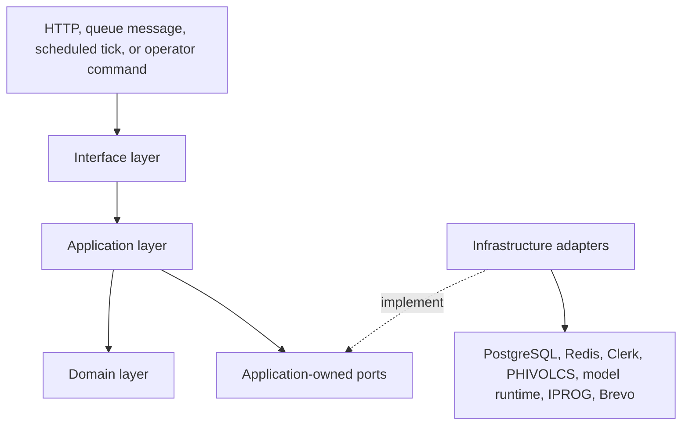

Interface calls Application; Application uses Domain. Domain contains no Express, Celery, PostgreSQL, Redis, or provider dependencies.
Infrastructure supplies adapters for the ports. It supports the three layers and is not a fourth business tier.
A **composition root** is startup code that creates adapters and supplies them to use cases.
Adapters implement access and transaction mechanics; Domain owns business decisions.

Application defines which writes and audits must succeed together. PostgreSQL adapters enforce those transactions, constraints, and concurrency checks.
Queue publication and provider calls occur outside database transactions, with recorded work and outcomes supporting recovery.

### The same pattern in Backend and workers

| Part | Backend example | Prediction Worker example |
| --- | --- | --- |
| Interface | Account HTTP route | Prediction queue handler |
| Application | `AccountService` | `ExecutePrediction` |
| Domain | Account settings and identity rules | Forecast validation and window rules |
| Port | `AccountStore` | `PredictionStore`, `PredictionModel` |
| Adapter | `PostgresAccounts` | `SqlAlchemyPredictionStore`, `SeisModel` |
| Composition root | Backend `server.ts` | Prediction worker startup and delivery setup |

Not every task needs every adapter. A pure validation rule needs no database or provider call.
Folder names identify ownership; the responsibility determines the layer. Worker entry points need not live in a directory named `interface`.

### Common principles

| Principle | Meaning in this system |
| --- | --- |
| Dependency direction | Interface calls Application; Application uses Domain and ports. Domain stays independent of frameworks, databases, and providers. |
| Dependency injection | Startup supplies concrete adapters. A use case asks for `AccountStore`, not a PostgreSQL connection. |
| Transaction boundary | Related durable changes succeed together. An event revision and its eligible prediction work commit in one transaction. |
| Separation of responsibilities | Domain decides eligibility; Application coordinates the task; adapters perform SQL, queue publication, or provider calls. |
| Idempotency | Repeated delivery of the same command does not create duplicate logical results or repeat uncertain provider submissions blindly. |
| Contracts | OpenAPI and queue schemas define exchanged data. They do not grant database access or replace Domain rules. |

### Example: trusted account email

Email change is unavailable. A stored account email must match the authenticated, verified identity before protected account operations proceed.

| Layer or adapter | Responsibility |
| --- | --- |
| Interface | Authenticate the request and map a rejection to a bounded public error. Expose no email-change mutation. |
| Application | Coordinate the requested operation through `AccountStore`, with Domain-guarded account reads, writes, and required audits. |
| Domain | `requireTrustedEmail` rejects missing stored verification evidence or a mismatch between the authenticated email and stored account email. |
| Infrastructure | Verify Clerk evidence and apply `requireTrustedEmail` to stored values on reads and inside locked write transactions. |

Identity belongs to the stable Clerk user ID, not an email address or phone number. A mismatch fails closed instead of silently replacing account identity.
The rule lives in [domain/accounts.ts](../../../apps/backend-api/src/domain/accounts.ts); [PostgresAccounts](../../../apps/backend-api/src/infrastructure/postgres/accounts.ts) invokes it after reading stored evidence.
Domain errors carry a code, message, and optional field. [accountErrors.ts](../../../apps/backend-api/src/interface/http/accountErrors.ts) maps those codes to HTTP statuses in Interface.

## Modules and ownership

| Module | Responsibility |
| --- | --- |
| Bulletin | Public earthquake, forecast, and replay views; account and alert-setting screens. |
| Backend API | Public information queries, authenticated account operations, phone verification, and authenticated delivery callbacks. |
| Beat | One five-minute ingestion schedule and durable run creation. |
| Dispatcher | Submission of committed ingestion, prediction, and alert commands to their queues. |
| Data Ingestor | Source retrieval, reconciliation, revisions, history evidence, and prediction inputs. |
| Prediction Worker | Verified inference, immutable forecasts, and eligible automatic alert creation. |
| Alert Worker | Recipient eligibility, frozen messages, and email/SMS submission. |
| Alert reconciliation | Recovery and reconciliation of uncertain delivery outcomes, including SMS status checks. |
| Host maintenance | Encrypted backups, isolated restore tests, and bounded retention cleanup. |

A module's container provides process isolation. PostgreSQL remains shared under restricted roles and explicit record ownership.
Containers do not provide high availability or independent ownership of the shared database.

## Module focus views

The paths below are relative to the repository root. Each table connects a responsibility to its owning source file or folder.
The Backend and workers share the layer pattern, not one shared service object or one shared Domain implementation.
Each focus view contains an architecture diagram, a file map, and one representative sequence.
Architecture diagrams show responsibilities and connections. Sequence diagrams show the order of one workflow rather than every possible operation.

### Bulletin: the client and web presentation

Bulletin presents public event information and account controls. Its Astro server prepares pages; React handles interactive maps, replay, and forms.
The browser and Astro server use the Backend contract. Account identity uses Clerk, while durable application changes pass through Backend.

#### Bulletin architecture

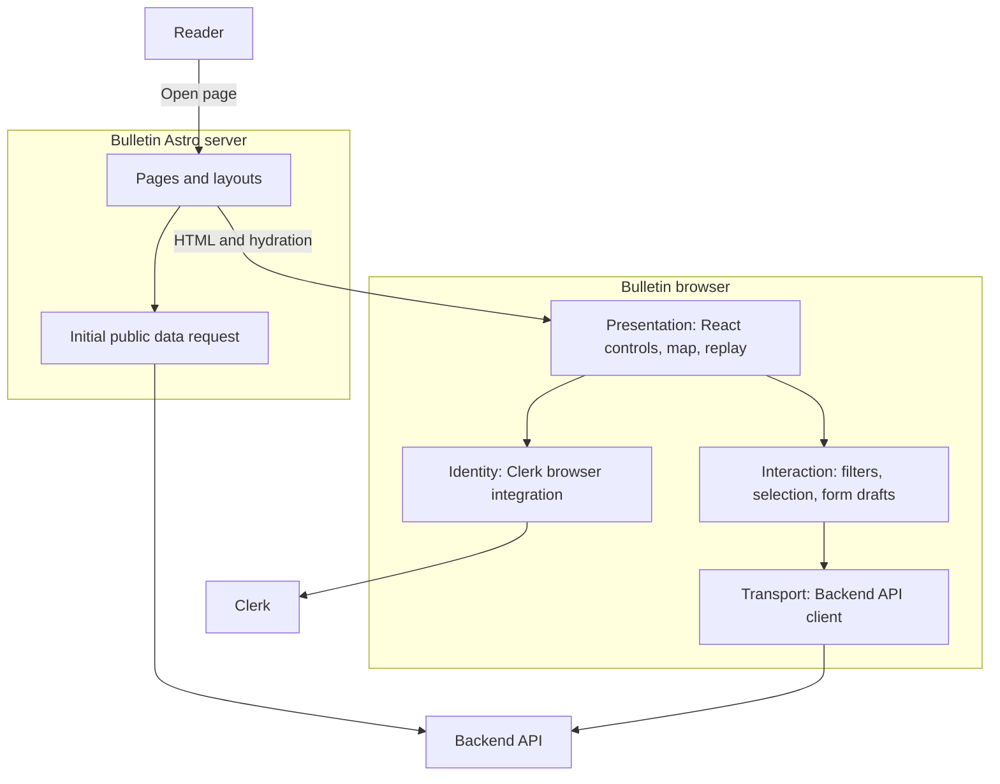

| Responsibility | Files and folders |
| --- | --- |
| Pages and page composition | [pages/](../../../apps/quakestrikeph-bulletin/src/pages/) and [layouts/](../../../apps/quakestrikeph-bulletin/src/layouts/) |
| Visible controls and maps | [components/](../../../apps/quakestrikeph-bulletin/src/components/) and shared [packages/ui/](../../../packages/ui/) |
| Interaction workflows | [features/accounts/](../../../apps/quakestrikeph-bulletin/src/features/accounts/), [features/event-results/](../../../apps/quakestrikeph-bulletin/src/features/event-results/), [features/forecast-replay/](../../../apps/quakestrikeph-bulletin/src/features/forecast-replay/) |
| Backend transport and generated types | [lib/api/](../../../apps/quakestrikeph-bulletin/src/lib/api/) |
| Clerk browser integration | [lib/auth/](../../../apps/quakestrikeph-bulletin/src/lib/auth/) |

The frontend separates presentation, interaction state, and transport. It does not duplicate server authority over account ownership or alert eligibility.
An input check improves feedback; Backend still decides whether an operation is allowed.

#### Example sequence: open Bulletin and change filters

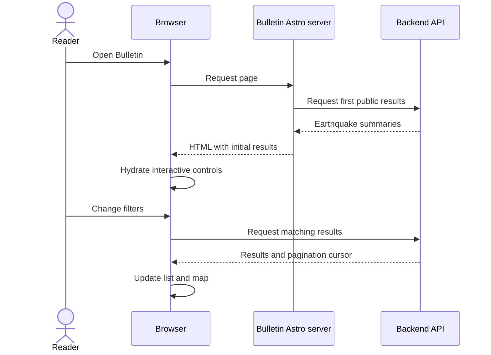

### Backend API: public reads and account operations

The Backend accepts HTTP requests, coordinates application workflows, and returns bounded public responses.
Its adapters handle PostgreSQL, Redis, Clerk, and IPROG. Brevo callbacks use the approved reconciliation capability rather than unrestricted delivery-table writes.

#### Backend architecture

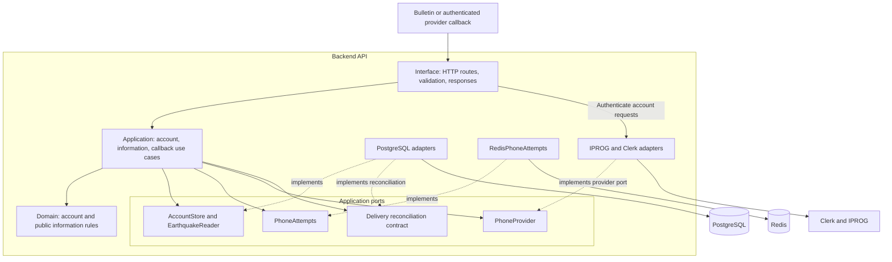

| Part | Files and folders | Responsibility |
| --- | --- | --- |
| Interface | [interface/http/](../../../apps/backend-api/src/interface/http/), [accountErrors.ts](../../../apps/backend-api/src/interface/http/accountErrors.ts) | Routes, request shape checks, response formatting, and mapping account error codes to HTTP statuses. |
| Application | [application/accounts/service.ts](../../../apps/backend-api/src/application/accounts/service.ts), [application/information/](../../../apps/backend-api/src/application/information/), [application/alerts/brevo.ts](../../../apps/backend-api/src/application/alerts/brevo.ts) | Account tasks, public queries, and callback coordination. |
| Domain | [domain/accounts.ts](../../../apps/backend-api/src/domain/accounts.ts), [domain/information.ts](../../../apps/backend-api/src/domain/information.ts) | Account invariants, `requireTrustedEmail`, preference limits, public information rules, and transport-independent errors. |
| Ports | [ports/accounts.ts](../../../apps/backend-api/src/ports/accounts.ts), [ports/earthquakeReader.ts](../../../apps/backend-api/src/ports/earthquakeReader.ts), [ports/alertDelivery.ts](../../../apps/backend-api/src/ports/alertDelivery.ts) | Capabilities needed by the workflows. |
| Adapters | [infrastructure/postgres/](../../../apps/backend-api/src/infrastructure/postgres/), [infrastructure/redis/phoneAttempts.ts](../../../apps/backend-api/src/infrastructure/redis/phoneAttempts.ts), [infrastructure/clerk/](../../../apps/backend-api/src/infrastructure/clerk/), [infrastructure/sms/iprog.ts](../../../apps/backend-api/src/infrastructure/sms/iprog.ts) | SQL, temporary verification storage, identity evidence, and provider requests. |
| Composition root | [server.ts](../../../apps/backend-api/src/server.ts) | Create clients and adapters, inject services, and start HTTP. |

For example, `AccountService` receives `AccountStore`, `PhoneAttempts`, and `PhoneProvider` ports.
Startup supplies `PostgresAccounts`, `RedisPhoneAttempts`, and `Iprog` as the concrete adapters.

#### Example sequence: save alert preferences

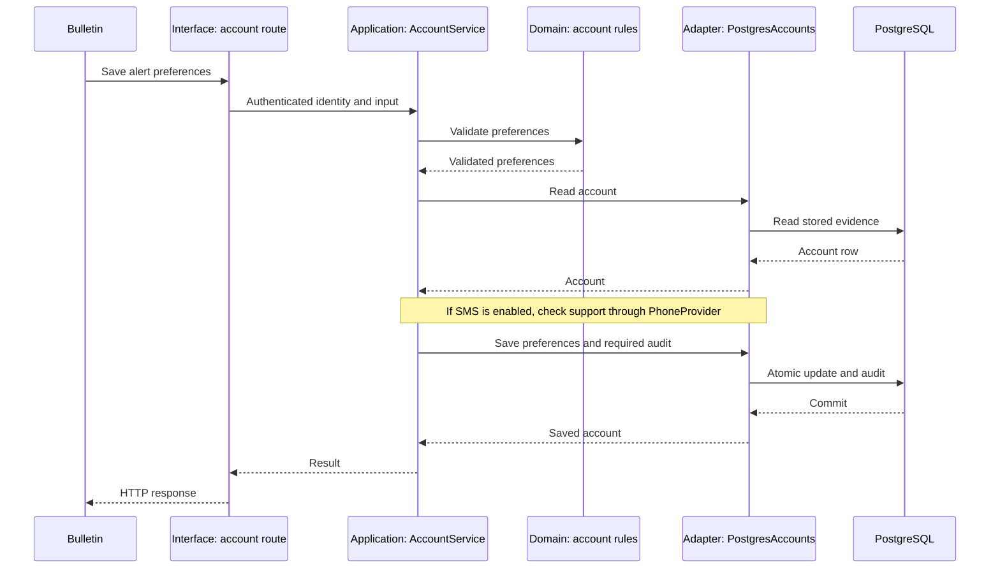

This sequence shows successful task flow. Transaction-time checks still protect against changes between the initial read and the write.

### Scheduler: Beat and Dispatcher

Beat decides when to request ingestion. Dispatcher delivers committed work to the right queue.
These are separate processes: a tick creates database records; queue publication follows their commit.

#### Scheduler architecture

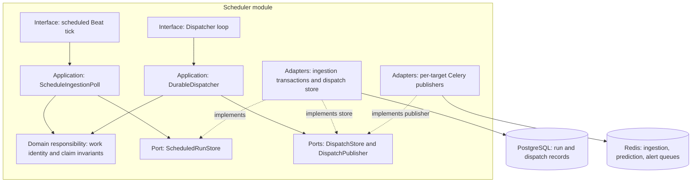

| Part | Files and folders | Responsibility |
| --- | --- | --- |
| Interface | [scheduler/beat.py](../../../workers/src/quakestrike/scheduler/beat.py), [scheduler/dispatcher.py](../../../workers/src/quakestrike/scheduler/dispatcher.py) | Scheduled ticks, dispatch loop, and service lifecycle. |
| Application | [application/scheduling.py](../../../workers/src/quakestrike/application/scheduling.py), [application/dispatch.py](../../../workers/src/quakestrike/application/dispatch.py) | `ScheduleIngestionPoll` and `DurableDispatcher`. |
| Domain responsibility | Run and dispatch invariants applied through the scheduling and dispatch contracts. | Preserve one logical run, valid claims, and safe repeated submission; no separate scheduler Domain class is required. |
| Ports | `ScheduledRunStore` in scheduling; `DispatchStore` and `DispatchPublisher` in dispatch. | Request atomic work creation and queue submission without choosing storage or broker libraries. |
| Adapters | [database/repositories.py](../../../workers/src/quakestrike/infrastructure/database/repositories.py), [database/dispatch.py](../../../workers/src/quakestrike/infrastructure/database/dispatch.py), [queues/](../../../workers/src/quakestrike/infrastructure/queues/) | PostgreSQL claims and per-target Celery publishers. |

One Dispatcher serves ingestion, prediction, and alert dispatches. A dispatch claim authorizes publication; a processing lease authorizes a worker's work.

#### Example sequence: schedule and publish ingestion

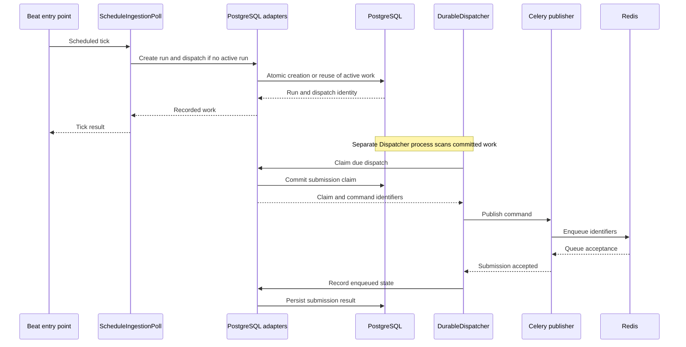

### Data Ingestor: source to event revision

The Data Ingestor retrieves PHIVOLCS bulletins, matches event identities, and records accepted revisions.
It prepares eligible prediction inputs and durable prediction work. Dispatcher handles later queue publication.

#### Data Ingestor architecture

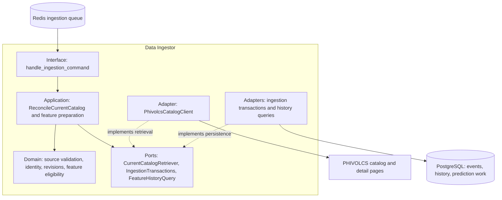

| Part | Files and folders | Responsibility |
| --- | --- | --- |
| Interface and startup | [data_ingestor/worker.py](../../../workers/src/quakestrike/data_ingestor/worker.py) | Parse the queue command, match recorded work, and assemble the workflow. |
| Application | [application/reconciliation.py](../../../workers/src/quakestrike/application/reconciliation.py), [application/features.py](../../../workers/src/quakestrike/application/features.py) | `ReconcileCurrentCatalog` and prediction snapshot preparation. |
| Domain | [domain/source_rows.py](../../../workers/src/quakestrike/domain/source_rows.py), [domain/reconciliation.py](../../../workers/src/quakestrike/domain/reconciliation.py), [domain/features.py](../../../workers/src/quakestrike/domain/features.py) | Accepted observations, stable identity, revisions, history coverage, and feature rules. |
| Ports | [application/phivolcs.py](../../../workers/src/quakestrike/application/phivolcs.py), [application/persistence.py](../../../workers/src/quakestrike/application/persistence.py), [application/features.py](../../../workers/src/quakestrike/application/features.py) | `CurrentCatalogRetriever`, `IngestionTransactions`, and `FeatureHistoryQuery`. |
| Adapters | [phivolcs/client.py](../../../workers/src/quakestrike/infrastructure/phivolcs/client.py), [database/repositories.py](../../../workers/src/quakestrike/infrastructure/database/repositories.py), [database/feature_history.py](../../../workers/src/quakestrike/infrastructure/database/feature_history.py) | Bounded source retrieval, SQL transactions, and historical queries. |

One event transaction preserves event identity, adds any new revision, and creates eligible prediction work together.
An absent row on the current source page does not delete stored history. Missing prediction evidence remains an explicit skip, not invented history.

#### Example sequence: accept a bulletin and prepare prediction work

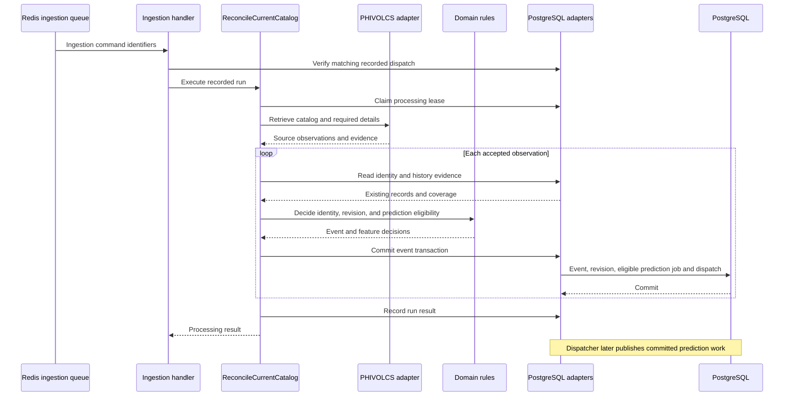

### Prediction Worker: inputs to forecast

The Prediction Worker loads a recorded input snapshot and its verified model release. It validates model output before saving a forecast.
Eligible current live forecasts create alert work in the same result transaction. Historical recovery and backfill do not create automatic alerts.

#### Prediction Worker architecture

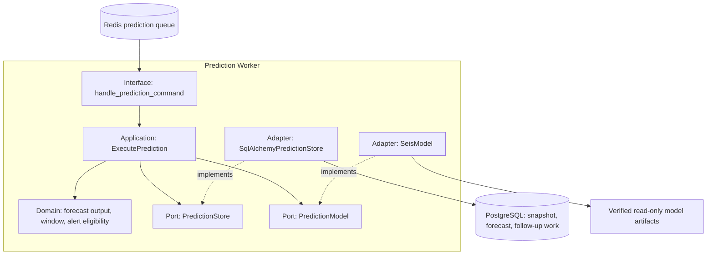

| Part | Files and folders | Responsibility |
| --- | --- | --- |
| Interface and startup | [prediction_worker/worker.py](../../../workers/src/quakestrike/prediction_worker/worker.py) | Validate the command, assemble adapters, and invoke the use case. |
| Application | [application/prediction.py](../../../workers/src/quakestrike/application/prediction.py) | `ExecutePrediction` coordinates claim, inference, validation, completion, or failure. |
| Domain | [domain/prediction.py](../../../workers/src/quakestrike/domain/prediction.py) and [domain/alerts.py](../../../workers/src/quakestrike/domain/alerts.py) | Valid forecast output, original window, and automatic-alert eligibility. |
| Ports | `PredictionStore` and `PredictionModel` in application/prediction.py. | Claim/save recorded work and run inference. |
| Adapters | [database/prediction.py](../../../workers/src/quakestrike/infrastructure/database/prediction.py), [models/seis.py](../../../workers/src/quakestrike/infrastructure/models/seis.py), [models/release_manifest.py](../../../workers/src/quakestrike/infrastructure/models/release_manifest.py) | `SqlAlchemyPredictionStore`, `SeisModel`, and verified artifact loading. |

The queue carries identifiers rather than model inputs. PostgreSQL holds the immutable snapshot; the model adapter reads the approved artifacts.
Domain output validation remains independent of the model library used for inference.

#### Example sequence: generate and save a forecast

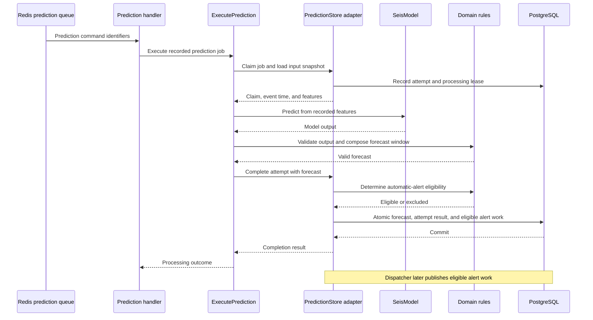

### Alerts: recipients, delivery, and reconciliation

The alert module resolves recipients and submits frozen messages through each enabled channel.
The Alert Worker consumes commands. A separate reconciliation process checks later outcomes; Backend receives authenticated Brevo callbacks.

#### Alert architecture

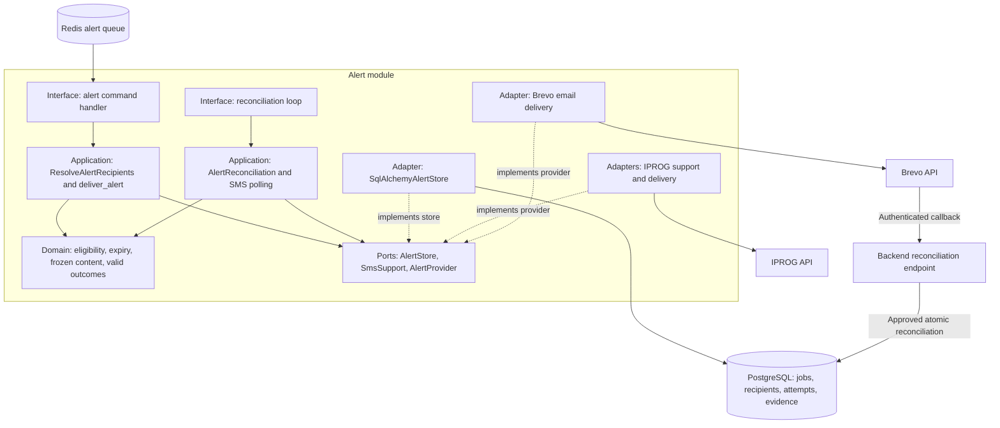

| Part | Files and folders | Responsibility |
| --- | --- | --- |
| Interface and startup | [alert_worker/worker.py](../../../workers/src/quakestrike/alert_worker/worker.py), [alert_worker/reconciliation.py](../../../workers/src/quakestrike/alert_worker/reconciliation.py) | Alert commands and bounded reconciliation scans. |
| Application | [application/alerts.py](../../../workers/src/quakestrike/application/alerts.py), [application/alert_delivery.py](../../../workers/src/quakestrike/application/alert_delivery.py), [application/alert_reconciliation.py](../../../workers/src/quakestrike/application/alert_reconciliation.py), [application/sms_polling.py](../../../workers/src/quakestrike/application/sms_polling.py) | Resolve recipients, coordinate submissions, and reconcile delivery evidence. |
| Domain | [domain/alerts.py](../../../workers/src/quakestrike/domain/alerts.py) | Channel eligibility, magnitude/nearby rules, expiry, and frozen content. |
| Ports | `AlertStore`, `SmsSupport` in application/alerts.py; `AlertProvider` in application/alert_delivery.py. | Recorded delivery work, sender support, and provider operations. |
| Adapters | [database/alerts.py](../../../workers/src/quakestrike/infrastructure/database/alerts.py), [sms/iprog.py](../../../workers/src/quakestrike/infrastructure/sms/iprog.py), [email/brevo.py](../../../workers/src/quakestrike/infrastructure/email/brevo.py) | Durable evidence and provider requests. |

Record a delivery attempt before calling a provider. The provider call occurs outside the database transaction.
Provider acceptance does not establish delivery or human receipt. Reconcile uncertain outcomes rather than blindly submitting the same message again.

#### Example sequence: submit and reconcile an alert

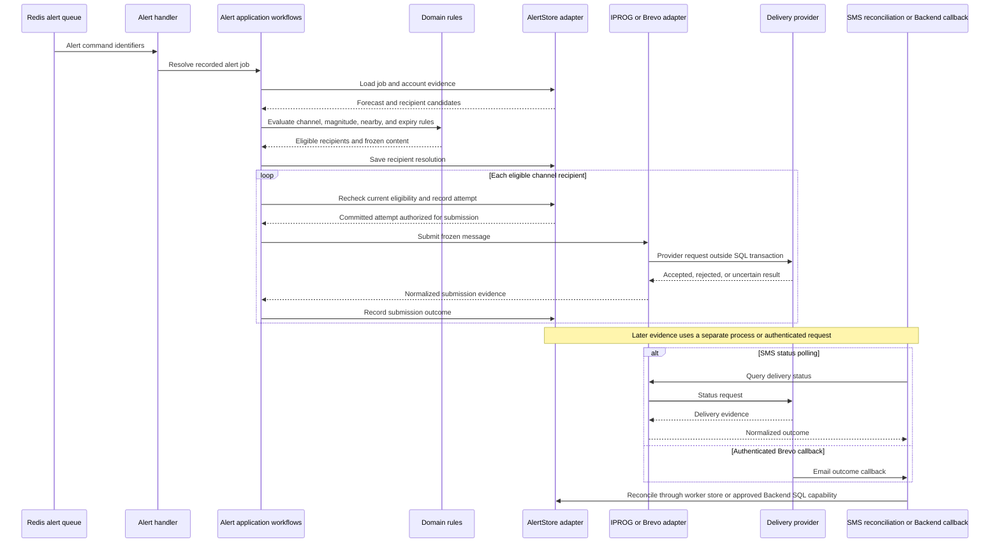

### Maintenance and release setup

Host maintenance protects data and records operational evidence. It runs independently of Beat and does not act as a public application endpoint.

#### Maintenance architecture

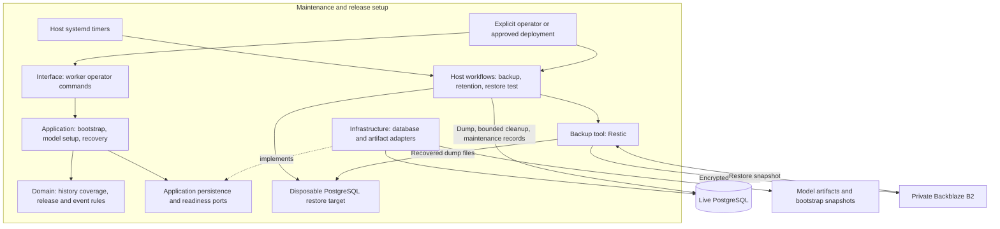

| Responsibility | Files and folders |
| --- | --- |
| Operator command boundary | [cli.py](../../../workers/src/quakestrike/cli.py), [operator_setup.py](../../../workers/src/quakestrike/operator_setup.py), [operator_runtime.py](../../../workers/src/quakestrike/operator_runtime.py) |
| Bootstrap, model setup, and recovery workflows | [application/bootstrap.py](../../../workers/src/quakestrike/application/bootstrap.py), [application/bootstrap_recovery.py](../../../workers/src/quakestrike/application/bootstrap_recovery.py), [application/model_releases.py](../../../workers/src/quakestrike/application/model_releases.py), [application/historical_recovery.py](../../../workers/src/quakestrike/application/historical_recovery.py) |
| Bootstrap recovery adapters | [infrastructure/bootstrap_recovery.py](../../../workers/src/quakestrike/infrastructure/bootstrap_recovery.py), [infrastructure/database/bootstrap_recovery.py](../../../workers/src/quakestrike/infrastructure/database/bootstrap_recovery.py) |
| Migration and restricted grants | [database/migrations/](../../../database/migrations/) and [database/initialization/](../../../database/initialization/) |
| Host timers, backups, restore tests, retention | [database/maintenance/](../../../database/maintenance/) |
| Coordinated deployment | [infrastructure/scripts/deploy-workers.sh](../../../infrastructure/scripts/deploy-workers.sh) |

Operator workflows reuse Application and Domain rules through their adapters. Host shell scripts handle operating-system orchestration and database administration.
Maintenance scripts do not need artificial classes for every layer. Their grants and transaction limits still preserve application ownership.

#### Example sequence: back up and verify recovery

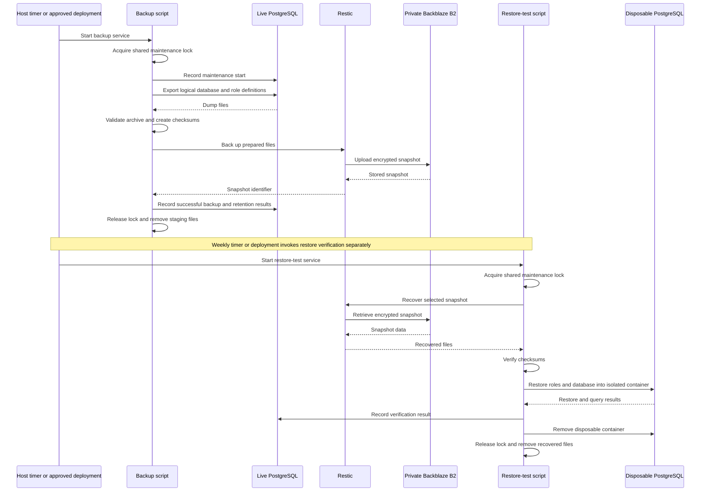

Backup and restore testing use separate services and schedules. Restore testing writes recovered business data only into the disposable database.
The live database receives maintenance evidence, not an automatic replacement of its business records.

## Repository structure

```text
quakestrikeph/
├── apps/
│   ├── quakestrikeph-bulletin/       # Astro, React, TypeScript
│   └── backend-api/                 # Node.js, Express, TypeScript
├── workers/
│   ├── Dockerfile                  # Shared worker image, distinct entry points
│   ├── prediction-worker/Dockerfile # Separate model dependencies
│   └── src/quakestrike/
│       ├── domain/                 # Pure business rules
│       ├── application/            # Use cases and ports
│       ├── infrastructure/         # Storage, queue, source, model, provider adapters
│       ├── scheduler/              # Beat and Dispatcher entry points
│       ├── data_ingestor/
│       ├── prediction_worker/
│       └── alert_worker/
├── packages/
│   ├── contracts/                  # OpenAPI and versioned queue schemas
│   └── ui/                         # Shared theme and UI controls
├── database/
│   ├── migrations/                 # Reviewed Alembic revisions
│   ├── initialization/             # Explicit roles, grants, release preparation
│   └── maintenance/                # Backup, restore-test, retention jobs
├── infrastructure/                 # Compose, Traefik routes, deployment scripts
└── model-artifacts/                 # Ignored model files, mounted read-only
```

Backend code uses `src/interface/http/`, `src/application/`, and `src/domain/`, with `src/ports/` and `src/infrastructure/` supporting those boundaries.
Worker HTTP, queue, scheduler, and command entry points perform Interface responsibilities regardless of their directory names.
The tree identifies in-scope ownership; deferred modules retain their separate directories and deployment definitions.

`packages/contracts` shares message definitions, not executable business logic or unrestricted database access.
Python and TypeScript maintain their own Domain code. Generate client types from the OpenAPI contract; share generated output only when multiple callers need it.

## Technology

| Area | Choice |
| --- | --- |
| Bulletin | Astro, React, TypeScript, shared UI components. |
| Backend | Node.js, Express, TypeScript. |
| Workers | Python 3.12, Celery, Celery Beat, uv. |
| Durable storage | PostgreSQL 16; Python adapters use SQLAlchemy 2 and Alembic. |
| Queues and temporary coordination | Redis 7. |
| Account identity | Clerk email/password and Google sign-in. Phone numbers are alert destinations, not sign-in identifiers. |
| Public edge | Cloudflare Tunnel, cloudflared, and Traefik file routes. |
| Prediction | Verified SEIS 1.0.1 model artifacts and a separate inference image. |
| SMS and phone verification | IPROG with supported shared-sender networks. |
| Alert email | Brevo transactional email, separate from Clerk authentication email. |
| Deployment and maintenance | Docker Compose, systemd timers, encrypted Restic backups in private Backblaze B2. |
| Private database inspection | Optional pgAdmin through Tailscale Serve with a read-only database login. |

Use tested, pinned image versions. Team-built release images use the tested Git commit SHA.

## Containers and networks

Cloudflare routes `quakestrikeph.com` through cloudflared to Traefik. Traefik sends `/api/v1/` to Backend and other public paths to Bulletin.
Production application services expose no host HTTP ports. PostgreSQL, Redis, and workers have no public routes or host data ports.

| Network or access path | Members | Purpose |
| --- | --- | --- |
| `backend-edge` | cloudflared, Traefik, Bulletin, Backend | Public routing and internal Bulletin-to-Backend HTTP. |
| `private-data` | PostgreSQL, Redis, Backend, worker services, explicit initialization jobs; optional pgAdmin | Internal database and broker access; no direct external egress. |
| `source-egress` | Data Ingestor, Alert Worker, alert reconciliation | Outbound PHIVOLCS and delivery-provider HTTPS. |
| `admin-access` | Optional pgAdmin | Support the private browser endpoint without exposing PostgreSQL. |
| Tailscale Serve | VPS host to loopback pgAdmin UI | Private operator HTTPS, separate from the public edge. |

Use Compose service names instead of fixed container IP addresses. Containers receive only required secrets and restricted database credentials.
Traefik uses explicit file routes without Docker socket access. Servers trust forwarding headers only from approved proxy paths.

### Compose responsibilities

All files below are under `infrastructure/`. Combine them explicitly for the required runtime.

| File | Purpose |
| --- | --- |
| `compose.yml` | Shared PostgreSQL, Redis, private network, and durable volumes. |
| `compose.release.yml` | Worker services, explicit release initialization, prediction/alert/Beat profiles, and source egress. |
| `compose.backend.yml` | Backend API and its private-data/backend-edge connections. |
| `compose.bulletin.yml` | Production Bulletin image and runtime. |
| `compose.edge.yml` | Traefik and cloudflared. |
| `compose.local.yml` | Local Bulletin development server, loopback web ports, and explicit local migration job. |
| `compose.admin.yml` | Optional private pgAdmin. |
| `compose.integration.yml` | Disposable database, Redis, and contributor test runners. |
| `compose.alert-verification.yml` | Explicit isolated alert-verification runner. |
| `compose.account-cleanup.yml` | Manual VPS test-account cleanup with explicit emails and preview confirmation; excluded from deployment. |
| `compose.domain-cutover.yml` | Explicit domain routing transition. |
| `compose.alert-testing.yml` | Deferred private test runtime, excluded from ordinary deployment. |

Local Bulletin, Backend, and workers share the `infrastructure` Compose project, database, and broker.
Local development excludes the public edge. Integration tests use the separate `quakestrike-data-ingestion-test` project and disposable data.

## Data, queues, and SMS

PostgreSQL stores ordinary events, revisions, model releases, forecasts, jobs, attempts, recipients, audits, and maintenance results.
The [database contract](../ERD/DATABASE-DESIGN.md) defines exact fields, constraints, transactions, and role permissions.

Redis has two ordinary roles:

- Broker for separate ingestion, prediction, and alert queues, with versioned identifier-only commands.
- Temporary account-bound SMS verification attempts, proof bindings, cooldowns, send limits, and concurrency locks.

IPROG sends verification codes and SMS alerts. Redis neither sends SMS nor replaces durable verified phone bindings or delivery records in PostgreSQL.
SMS verification and explicit SMS opt-in remain separate. Replacement pauses SMS until verification and a new opt-in.
Application coordinates verification through ports; Domain defines eligibility and valid transitions; Redis and IPROG adapters supply storage and transport.

Queue delivery is at least once. Durable jobs, leases, dispatch records, and idempotent processing prevent duplicate logical effects.
Dispatcher publishes only committed work. Worker completion commits the result and any follow-up job atomically before the next dispatch.

### Processing flow

1. Beat creates an ingestion run and dispatch record without overlapping an active run.
2. Dispatcher publishes the run identifier to the ingestion queue.
3. Data Ingestor validates source evidence, preserves event identity, appends revisions, and prepares eligible prediction work.
4. Dispatcher publishes prediction job identifiers after their transaction commits.
5. Prediction Worker uses the recorded input snapshot and verified release to store the forecast and eligible alert work.
6. Alert Worker rechecks account eligibility and forecast expiry before provider submission.
7. Reconciliation and authenticated callbacks record later delivery evidence without repeating uncertain submissions blindly.

Prediction inputs use validated prior history and exclude future outcomes. Forecasts retain the original 24-hour window from the observed event time.
Historical recovery and backfill create no automatic alerts. Provider acceptance, delivery evidence, and human receipt remain distinct.
New sends stop at forecast expiry; later provider outcomes may still update evidence.

Model releases and input snapshots are immutable. Model weights and source snapshots stay outside Git and image build contexts.
Finite bootstrap establishes required history and readiness. Runtime startup verifies readiness without silently migrating, importing, or registering releases.

## Security and operations

Backend verifies Clerk identity and authorizes account operations for the matching user. Protected mutations and their required success audits commit together.
Account removal and email change remain unavailable. Public responses exclude private recipients, raw security details, and internal worker errors.
Provider callbacks require authentication, bounded input, idempotent updates, and protection against regressing a delivered result.

Modules emit sanitized structured diagnostics to stdout/stderr. Docker bounds retained logs; selected technical records and required audits have separate storage rules.
Missing logs or maintenance records never establish successful processing or backups.

Host timers run daily encrypted PostgreSQL backups, weekly isolated restore tests, and bounded checkpoint cleanup independently of Beat.
Backups include logical data and role exports. Live database restoration requires an explicit recovery procedure.

Successful main CI deploys Backend, Bulletin, workers, and already-enabled alert services as one coordinated release when deployment is enabled.
An encrypted backup and isolated restore test precede explicit migration and grant work. Producers and affected services stop before schema changes.
Restore consumers and required web services before publication; enable Beat only after readiness. Initial provider activation and private secrets remain explicit setup actions.
Rollback uses previous images only when schema compatibility is established; changed or uncertain schemas require repair forward.

Database loss blocks data-backed work. Redis loss interrupts queues and SMS verification while persisted public information remains readable.
A VPS outage stops all local modules; separate containers do not remove this shared failure point.

## Deferred modules

| Module | Retained boundary |
| --- | --- |
| Operations Console | Separate Astro server behind Cloudflare Access, named operator identities, MFA, approved read-only queries, and audited access. No business writes or runtime controls. |
| Private alert-testing tool | Separate private Tailscale controls, isolated Redis state and consumer, temporary synthetic records, and explicit provider-send enablement. No ordinary job or forecast ownership. |

Console access uses its own verified identity rather than Bulletin accounts. Private testing uses separate `alert-test-access` and `alert-test-egress` networks.
Its isolated Redis owns temporary test sessions and synthetic evidence, not ordinary business records. Deferral does not change ordinary Redis queues or SMS verification.

## References

- [Database design](../ERD/DATABASE-DESIGN.md), [glossary](../../../GLOSSARY.md), and [product scope](../../../PRODUCT.md).
- [Operations index](../../operations/README.md) for setup, deployment, verification, and recovery procedures.
- [Architecture image](system-architecture-layers.png), [context image](../CFD-DFD/CFD.png), and [ERD image](../ERD/ERD.png).
- [Worker boundaries](../../adr/0011-python-runtime-and-durable-worker-operations.md), [queue contract](../../adr/0012-queue-topology-and-operational-safeguards.md), and [startup](../../adr/0019-explicit-startup-and-runtime-configuration.md).
- [Account rules](../../adr/0042-bulletin-account-implementation.md), [local runtime](../../adr/0043-shared-local-compose-runtime.md), and [coordinated deployment](../../adr/0049-automatic-full-application-deployment.md).
- [Console boundary](../../adr/0035-cloudflare-access-operations-console.md) and [private testing isolation](../../adr/0050-private-alert-testing-session-runtime.md).
