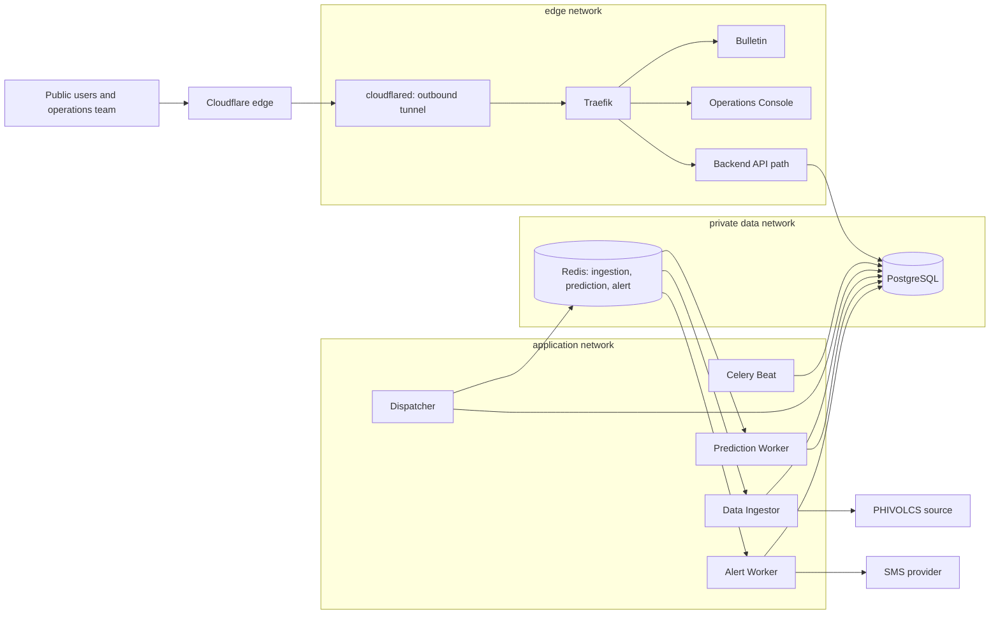

# QuakeStrike PH architecture specification

Status: intended platform design. The trees below specify ownership and dependency direction; they do not claim that the directories already exist or require every private filename to match an example.

QuakeStrike PH is a client-server system on one OVHcloud VPS-2 with 4 vCores, 8 GB RAM, and 75 GB NVMe storage. Two Astro applications use one shared Backend. The Backend and workers organize code into Interface, Application, Domain, and Infrastructure layers. Separate Docker containers provide process isolation, not independent data ownership, high availability, or microservices. PostgreSQL is the durable source of truth; Redis is a broker. The current system-view and data-flow PNGs still show the removed PHIVOLCS Monitoring application and review flow; they are temporarily stale until the separate diagram update. This written specification and the [database contract](../ERD/DATABASE-DESIGN.md) control meanwhile.

## Intended monorepo

```text
quakestrikeph/
├── apps/
│   ├── quakestrikeph-bulletin/       # Astro, React, TypeScript
│   ├── operations-console/          # Astro, React, TypeScript
│   └── backend-api/                 # Node.js, Express, TypeScript
├── workers/                         # one Python 3.12 / uv workspace
│   ├── pyproject.toml
│   ├── uv.lock
│   ├── Dockerfile                    # Beat, Dispatcher, Ingestor; distinct commands
│   ├── prediction-worker/Dockerfile # model runtime and its dependencies
│   ├── src/quakestrike/
│   │   ├── domain/
│   │   ├── application/
│   │   ├── infrastructure/
│   │   ├── scheduler/
│   │   ├── data_ingestor/
│   │   ├── prediction_worker/
│   │   ├── alert_worker/
│   │   └── cli.py
│   └── tests/
├── packages/
│   ├── contracts/                   # OpenAPI and versioned queue schemas
│   └── generated-clients/           # generated TypeScript/Python contract code
├── database/
│   ├── migrations/                  # hand-reviewed Alembic revisions
│   ├── initialization/              # release registration and readiness
│   └── maintenance/                 # retention, backup, restore-test commands
├── infrastructure/
│   ├── compose.yml
│   ├── compose.production.yml
│   ├── traefik/
│   ├── cloudflared/
│   ├── backup/
│   └── scripts/
├── model-artifacts/                # local, Git-ignored, build-excluded, read-only mount
├── .env.example
├── CONTEXT.md
└── docs/
```

`packages/contracts` describes HTTP and queue messages, not shared executable business logic. TypeScript and Python implement their own domain code. Do not create a cross-language `shared-backend` bucket that grants arbitrary SQL access. Share a module only when real callers need the same implementation. The [ingestion ADRs](../../adr/0011-python-runtime-and-durable-worker-operations.md) fix the Python runtime and the [queue contract](../../adr/0012-queue-topology-and-operational-safeguards.md) fixes command semantics.

## Technology stack

| Area | Technology | Role |
| --- | --- | --- |
| Web applications | Astro, React, TypeScript | Pages and interactive browser UI for the two client applications. |
| Backend | Node.js, Express, TypeScript | Shared HTTP interface, authorization, use cases, and client-facing transactions. |
| Workers | Python 3.12, Celery, Celery Beat, `uv` | Scheduling, durable dispatch, ingestion, prediction, and alert delivery. |
| Persistence | PostgreSQL 16, SQLAlchemy 2, Alembic | Durable application, audit, run, dispatch, delivery, and selected technical records. |
| Queue | Redis 7 | Separate Celery queues and short-lived coordination; never authoritative job state. |
| Identity | Clerk | Sign-in and sessions; Backend role policies authorize application actions. |
| Public edge | Cloudflare Tunnel, `cloudflared`, Traefik | Outbound tunnel and explicit reverse-proxy routes. |
| Prediction | Python model runtime and read-only `SEIS 1.0.1` artifacts | Verified training-compatible inference. |
| SMS | Provider to be selected | External alert submission and delivery callbacks. |
| Operations | Docker Compose, host scheduler, PostgreSQL records, bounded container logs | Deployment, maintenance, operational history, and local diagnostics. |
| Private database browser | pgAdmin 4, Tailscale Serve | Optional operator access to live PostgreSQL through a read-only role. |

Pin exact tested patch versions in deployment configuration. The major versions above follow the accepted runtime decisions; they are not permission to use floating image tags.

## Container and network layout



Cloudflare sends only the two application hostnames through the tunnel. Traefik routes application pages and an explicit `/api` path on those hostnames to the Backend. Browser requests to the Backend stay on the public HTTPS origin; they never use a Docker-only address. Only `cloudflared` connects to Cloudflare, and only Traefik accepts tunnel traffic. Traefik has no public dashboard. PostgreSQL, Redis, and worker endpoints have neither tunnel routes nor host port mappings. Containers use Compose service names, not cached IP addresses. Browser code receives no database, Redis, or provider secrets.

The optional pgAdmin container joins the private data network and has a
loopback-only HTTP port on the VPS. Tailscale Serve gives operators a private
HTTPS URL in the tailnet. PgAdmin does not receive a public Cloudflare or
Traefik route. Its PostgreSQL login has read-only grants; see
[ADR 0029](../../adr/0029-private-production-database-browser.md). The
loopback mapping is for the pgAdmin web UI, not PostgreSQL port 5432.

| Network | Members | Permitted traffic |
| --- | --- | --- |
| Edge | `cloudflared`, Traefik, two web apps, Backend HTTP entry | Tunnel to explicit page and `/api` routes only. |
| Application | Backend and worker processes | Internal coordination and service health where needed; no public worker route. |
| Private data | Backend, workers, PostgreSQL, Redis | Restricted database roles and typed queue commands. |
| Private operator access | pgAdmin on the private data network; Tailscale Serve on the VPS host | Tailnet HTTPS to loopback pgAdmin UI; read-only PostgreSQL login. |

External PHIVOLCS, Clerk, and SMS calls use HTTPS. The exact Compose network names are incidental; exposure rules are not. Cloudflare Tunnel and Traefik handle routing, not authorization. TLS termination and forwarding headers must be configured so the Backend trusts only known proxy hops.

## Web applications

Both apps use Astro for pages, React for interactive islands, and TypeScript. Each has its own image and deployment. They render UI, hold transient client state, and call the versioned Backend HTTP interface. They never perform direct SQL, queue publication, model inference, or privileged authorization. Clerk handles sign-in; the Backend verifies protected requests and checks live PostgreSQL role assignments.

```text
apps/<web-app>/
├── Dockerfile
├── package.json
├── astro.config.*
├── src/
│   ├── pages/             # Astro routes and page composition
│   ├── components/        # shared-in-app Astro and React UI
│   ├── features/          # app-owned screens and interaction logic
│   ├── lib/api/           # generated HTTP client wrapper, errors, auth handoff
│   ├── lib/auth/          # Clerk browser integration
│   └── styles/
└── tests/
```

The Bulletin owns public event, forecast, and playback views, plus authenticated profile and SMS alert-setting screens. Valid persisted forecasts need no review or approval before the public information path can return them. The Operations Console owns read-only run/job/delivery summaries, selected logs, audits, maintenance status, and direct forecast-versus-observation comparisons. It has no Docker socket, host-log reader, database connection, user-management authority, or container-control feature.

Put app-specific routes under each app's `pages/` and `features/`. Put only genuinely reused browser code in a TypeScript package. The generated client follows `packages/contracts/openapi.yaml`; applications must not hand-roll divergent request shapes. The Console shows missing or stale records as unavailable or stale, never as a healthy zero. It does not claim live CPU, memory, disk, container restart, Redis depth, or request-rate metrics without an explicit collector. A comparison is per forecast and calls screened observations possibly related earthquakes, not confirmed aftershocks or a model-accuracy study.

## Shared Backend

The one Backend uses Node.js, Express, and TypeScript. It serves both clients through versioned HTTP routes. Its layers are code responsibilities inside one deployable module, not separate physical tiers.

```text
apps/backend-api/
├── Dockerfile
├── package.json
├── src/
│   ├── interface/http/
│   │   ├── routes/         # public, account, operations, admin
│   │   ├── middleware/     # request IDs, Clerk verification, validation
│   │   └── responses/      # contract mapping and error handling
│   ├── application/
│   │   ├── accounts/       # profile and SMS settings
│   │   ├── information/    # public events and forecasts
│   │   ├── access/         # role assignment use cases
│   │   └── operations/     # bounded summaries, logs, audits, comparisons
│   ├── domain/             # access, revision, and alert-setting rules
│   ├── ports/              # interfaces consumed by application/domain
│   ├── infrastructure/
│   │   ├── postgres/       # approved repositories, transactions, queries
│   │   ├── clerk/          # identity verification adapter
│   │   ├── logging/        # structured diagnostics and selected SQL logs
│   │   └── queue/          # durable dispatch creation, not direct sends
│   └── config/             # typed environment-backed settings
└── tests/
```

HTTP routes verify identity, validate requests, and format responses. Application use cases coordinate transactions and call declared interfaces. Domain rules decide access, public visibility, alert settings, and idempotency without importing Express, PostgreSQL, Redis, or Clerk. Infrastructure adapters implement the interfaces. Dependencies point inward; routes and adapters do not become the place where business policy is defined. The Backend never calls its own public HTTP routes to do internal work.

Clerk's stable user ID maps uniquely to an application user. Every protected request loads current assignments; revoked or unavailable assignments deny privileged access. `operations_viewer` and `access_administrator` are independent roles. Public registration grants none. The Backend owns audited role changes, profile changes, phone verification, and SMS alert settings. The Console uses narrowly approved read queries and a separate restricted append-only path for access audits. It cannot use that path to forge arbitrary actors or alter records.

## Background workers and queues

One Python 3.12 workspace uses `uv`, Celery, synchronous SQLAlchemy 2, and hand-reviewed Alembic migrations. Queue handlers are the Interface layer; use cases and pure rules sit inward; PostgreSQL, Redis, PHIVOLCS, model, SMS, and logging code are adapters. The workers do not call Backend HTTP routes for internal data work. Separate Beat, Dispatcher, and Ingestor containers share an application image with distinct commands. Prediction has a separate Python image for model dependencies. The Alert Worker is also Python/Celery and may use the base worker image if its provider dependencies fit.

```text
workers/src/quakestrike/
├── domain/                 # source identity, eligibility, leases, idempotency
├── application/            # reconciliation, feature, prediction, delivery use cases
├── infrastructure/
│   ├── database/           # SQLAlchemy repositories and unit-of-work
│   ├── phivolcs/           # bounded catalog and detail HTTP retrieval
│   ├── queues/             # Celery tasks and versioned commands
│   ├── models/             # manifest and read-only artifact loader
│   ├── sms/                # provider and callback adapters
│   └── logging/            # JSON stdout/stderr and selected SQL records
├── scheduler/              # Beat tick; durable Dispatcher loop
├── data_ingestor/          # queue handler, reconcile and feature orchestration
├── prediction_worker/      # queue handler, inference, result commit
├── alert_worker/           # queue handler, recipient/send/reconcile flow
└── cli.py                  # explicit bootstrap, release, recovery commands
```

Beat alone owns the five-minute schedule. It creates one pending `ingestion_runs` record and its `job_dispatches` row in a PostgreSQL transaction, avoiding overlap with an active run. The long-lived Dispatcher claims committed dispatch rows, publishes IDs-only commands to the corresponding Redis/Celery queue, and records submission state. Its claim is not the worker's processing lease. The Ingestor claims the same logical run, fetches the full current PHIVOLCS catalog and detail URLs for new or changed catalog rows, validates and reconciles rows, then commits event revisions and any eligible prediction job plus dispatch row atomically. The Ingestor does not publish prediction commands directly; after commit, the shared Dispatcher claims the existing prediction dispatch and routes it to the prediction queue. Missing catalog structure or a conflicting duplicate bulletin ID fails the run; invalid or ambiguous individual rows are counted and do not block valid rows. A detail-page failure preserves a valid catalog row at minute precision with nullable origin and a diagnostic. Absent current-page rows do not delete history. See [identity](../../adr/0013-revision-level-source-identifiers.md), [enrichment](../../adr/0020-detail-page-enrichment.md), [reuse](../../adr/0033-reuse-stored-live-bulletin-details.md), and [atomic processing](../../adr/0016-atomic-event-processing-and-release-registration.md).

A new or changed M1+ revision can create prediction work only with a valid URL, source identity, a configured verified release, seven days of prior history, and a complete versioned feature snapshot. The v1 snapshot contains exactly `anchor_magnitude`, `anchor_depth_km`, `anchor_latitude`, `anchor_longitude`, `anchor_time_is_minute_precision`, `catalog_m1_plus_count_past_1h`, `catalog_m1_plus_count_past_24h`, `catalog_m1_plus_count_past_7d`, `local_m1_plus_count_past_24h_within_50km`, and `local_m1_plus_count_past_24h_within_100km`. It excludes future outcomes and uncertain same-minute ordering. Snapshot JSON and SHA-256 remain immutable. The Prediction Worker loads the referenced job and verified `SEIS 1.0.1` release, runs the selected model routes, and atomically records an attempt, immutable forecast, and one alert job with dispatch and audit for every current, unexpired live M1+ forecast. Historical and backfill work create no alert job. See [feature contract](../../adr/0021-live-feature-contract.md), [automatic-alert scope](../../adr/0027-automatic-alerts-without-forecast-review.md), and [database transaction rules](../ERD/DATABASE-DESIGN.md#transactions-and-cross-table-rules).

The Alert Worker accepts only durable automatic alert work. It resolves unique recipients from active accounts whose verified mobile number remains current, SMS remains enabled, and alert trigger magnitude is no greater than the observed anchor magnitude. When a user enables nearby-only alerts, the observed epicenter must also be within the user's saved alert-location radius. It snapshots eligibility, rechecks current settings and expiry before each new SMS call, and persists an attempt before calling the provider. Provider submission is outside the SQL transaction. Unknown outcomes require reconciliation, not blind resend; callbacks cannot regress a delivered result. A job stops new sends at its forecast window end, while late outcomes may still update evidence. See the [alert tables](../ERD/DATABASE-DESIGN.md#alerts) and [nearby-alert decision](../../adr/0030-optional-nearby-sms-alerts.md).

Redis has separate ingestion, prediction, and alert queues. Commands carry a version and stable database identifiers, never scraped HTML, full events, or CSV paths. PostgreSQL owns status, retries, leases, dispatch, and idempotency. Celery uses late acknowledgement and worker-loss rejection; duplicate delivery is expected. The [queue ADR](../../adr/0012-queue-topology-and-operational-safeguards.md) sets the initial dispatcher batch, lease, concurrency, and retry safeguards. Manual recovery requeues existing run/dispatch identities rather than manufacturing replacements.

## Contracts, data, and model assets

`packages/contracts` holds the versioned OpenAPI definition, queue-message schemas, and their compatibility rules. Generated clients and models are derived outputs, not a second source of truth. A contract change must remain compatible with still-running containers during deployment or require a coordinated release. The Backend and Python workers can read shared PostgreSQL data only through purpose-specific adapters and restricted roles. The [database specification](../ERD/DATABASE-DESIGN.md) controls tables, ownership, constraints, and transactions.

| Records | Writer | Other consumers |
| --- | --- | --- |
| Events and revisions | Data Ingestor | Backend, Prediction Worker, Operations queries |
| Ingestion run | Beat creates; Ingestor processes | Operations queries |
| Dispatch submission | Dispatcher, after a creator inserts the row | Workers, Operations queries |
| Prediction jobs and snapshots | Data Ingestor | Prediction Worker, Operations queries |
| Prediction attempts and forecasts | Prediction Worker | Backend, Alert Worker, Operations queries |
| Profiles, SMS settings, and roles | Backend | Alert Worker and authorized reads |
| Automatic alert jobs | Prediction Worker | Alert Worker, protected queries |
| Recipients and delivery attempts | Alert Worker | Backend and Operations queries |
| Audits and selected technical logs | Acting/emitting server module | Protected Operations query path |
| Maintenance results | Restricted host maintenance scripts | Protected Operations query path |

PostgreSQL runs in its own container on `postgres_data`; Redis uses a named volume when queue persistence is enabled. Neither volume is an off-VPS backup. Use separate migration, Backend, worker, operations-read, maintenance, and backup database roles with grants limited to their work. PostgreSQL has a `pg_isready` health check and no public port 5432 mapping. Redis is not the system of record. The model release row is immutable; the normalized manifest records exact routes, target mappings, features, runtime provenance, and SHA-256 hashes. `MODEL_RELEASE_ID` selects a release explicitly. Model weights and bootstrap source snapshots stay out of Git and Docker build contexts; weights mount read-only. CSV is not a second live store. See [release](../../adr/0009-immutable-model-releases-and-ingestion-feature-snapshots.md) and [bootstrap readiness](../../adr/0022-idempotent-revisions-and-bootstrap-gates.md).

## Security and access

Clerk authenticates; the Backend authorizes with current PostgreSQL assignments. No local password service or environment allowlist is the continuing role store. Seed the first access administrator once through a controlled, audited command. An administrator does not automatically gain viewer powers. Deny protected work if role lookup fails. Public endpoints never return recipient snapshots, raw security details, or technical logs. Privileged mutations and their success audits commit together. Failed or denied attempts use a bounded separate audit path and never claim a committed success.

Each container receives only required secrets and database grants. Store secrets in VPS-managed environment or secret files, not Git, browser code, Traefik labels, logs, or model manifests. Neither the Operations Console nor the Backend receives Docker socket access. Provider callbacks require provider-specific verification and idempotent status updates. Rate limiting and trusted proxy configuration protect HTTP entry. The [database contract](../ERD/DATABASE-DESIGN.md#audit-operations-and-dispatch) defines audit and delivery evidence.

## Logging, diagnostics, and maintenance

PostgreSQL stores business state, audit evidence, ingestion/prediction/delivery history, `maintenance_runs`, and selected sanitized `technical_logs`. It does not store every debug line or continuous host metrics. Each server module emits structured JSON diagnostics to stdout/stderr with service and correlation identifiers; include run, dispatch, job, revision, recipient, and request IDs when available. Do not log secrets, tokens, raw HTML, full payloads, or raw SQL. SQL technical-log writes are bounded and nonessential to ordinary processing. If they fail, write a sanitized stderr fallback without recursive or unlimited retry. Required success audits are different: the protected mutation fails if its audit cannot commit.

Docker retains bounded diagnostics using the `local` logging driver, about 20 MiB per file and five files per container initially. Debug verbosity is off by default. Container logs help during a PostgreSQL outage but may rotate or disappear with the VPS; they are not an audit archive. The Console reads SQL records only through Backend queries with date ranges, pagination, restricted views, and access audits. Missing maintenance records are not proof that backups ran. No OpenTelemetry Collector, Loki, Prometheus, or observability network belongs to this deployment. An external uptime check is needed because a VPS outage removes local visibility.

A host scheduler, independent of Beat, runs technical-log retention cleanup, encrypted off-VPS PostgreSQL backup, and isolated restore tests. Scripts record attempts and results in `maintenance_runs`. Cleanup uses a dedicated role, bounded batches, and a configurable short technical-log period; it must not delete audit or business history by applying that period indiscriminately. Backups include logical data and cluster-role exports, checksums, encryption before transfer, retention, and verification. Never copy a live PostgreSQL volume as the backup method. The 70% total-disk-use warning threshold needs a host check, not a fabricated Console metric. Recovery into the live database is controlled, not a routine scheduled restore.

Successful scheduled ingestion runs remove their checkpoints when their summary
commits. The host drains older successful-scheduled checkpoints and removes
other terminal-run checkpoints after 30 days in bounded batches. Run summaries
and source, event, forecast, and audit evidence remain. See
[ADR 0034](../../adr/0034-bound-successful-ingestion-checkpoints.md).

## Deployment and failure behavior

Pin exact tested official image tags; never deploy `latest`. Tag team-built images with the Git commit SHA and keep the previous tested image for rollback. Give long-running containers health checks, `restart: unless-stopped`, memory limits, and bounded logs. Services reconnect after database or broker restarts. Apply migrations once as an explicit job, register and hash-verify the model release, run and validate the finite bootstrap, start Dispatcher and Ingestor, then enable Beat only after readiness. Startup never silently migrates, imports, or changes the release registry. See [startup ADR](../../adr/0019-explicit-startup-and-runtime-configuration.md).

Release one changed image at a time when contracts permit. Back up before a destructive migration, check queue compatibility before replacing workers, and verify health, freshness, prediction, public forecast availability, alert idempotency, SQL filtering, required audits, log rotation, and SQL-log fallback. A stopped web app does not stop the others; a stopped worker leaves durable work pending or retryable. Backend loss blocks fresh client data operations. Redis loss pauses new background processing while stored data remains readable. PostgreSQL loss blocks data-backed operations and SQL logs, leaving only bounded container diagnostics. VPS loss stops all local modules. Separate containers limit process crashes but do not remove the shared VPS and database failure points.

## Decisions before deployment

Choose and record the SMS provider, sender identity, callback verification, phone-verification flow, country support, and cost limits before sending SMS. Set separate retention periods and budgets for technical, audit, run, and delivery records. Select the off-VPS backup destination, encryption tool, cadence, restore-test cadence, and secret store. Configure host disk checks and external uptime monitoring. Choose exact tested Node.js and container versions, and whether Traefik uses file routes or restricted Docker discovery. These are configuration and policy decisions, not permission to invent database columns or extra services.

## References

- [Architecture diagram](system-architecture-layers.png), [context diagram](../CFD-DFD/CFD.png), and [ERD](../ERD/ERD.png).
- [Domain context](../../../CONTEXT.md), [database design](../ERD/DATABASE-DESIGN.md), and [ADRs](../../adr/).
- Source design: `C:\Projects\SAM_Capstone\capstone\docs\03-proposed-architecture.md`. The source remains unchanged.
